# 核心用户流程

## 本章导读

本章定义 ATeam 从「一个人跑一个 Agent」到「小团队共享任务与机器」的六条核心用户流程。它们把 Task、Agent、Run、运行工作区（Run Workspace）、Runtime、Artifact/Evidence、Human Review、Merge 这些领域对象串成一条可操作、可验收、可审计的时间线。

阅读本章时，请把每条流程理解为一组「状态迁移 + 人工门 + 证据交接」，而不是界面操作说明。流程 A 与流程 E 是 M0/M1 必须跑通的底座；流程 B 与流程 D 是 M2.1 角色 Agent 协作的主干；流程 C 是 M2.2（即 M2 后置）的同任务 Crew 增强；流程 F 是 M3 团队模式。每条流程都包含：前置条件、主流程、交付物、异常路径、验收点，并明确区分当前已实现（M0）与计划中（M1-M4）。

本章所有功能需求使用本章独占的 `FLOW-` 编号，不再与 `02-domain-model.md` 的 `DM-` 前缀、`modules/*.md` 的 TASK/AGENT/RUN/SEC/COLLAB/UI/API/NFR 编号共用号段。编号规则见 1.5；跨文档引用一律写明文档名与编号。

本章中的状态标记约定如下：

| 标记 | 含义 |
|---|---|
| 已实现（M0） | 当前仓库代码已经具备该行为，可直接在本机验证 |
| 计划（M1） | 本地闭环里程碑交付，尚未实现 |
| 计划（M2） | 角色 Agent 协作里程碑交付，尚未实现 |
| 计划（M3） | 团队模式里程碑交付，尚未实现 |
| 计划（M4） | 自动化与分发里程碑交付，尚未实现 |

本章默认读者已经了解产品一句话定位与核心闭环：Task（上下文容器）→ Agent（可复用工作配置）→ Run（一次执行）→ 运行工作区（隔离执行环境）→ Runtime（Claude Code/Codex/mock）→ Artifact/Evidence（diff、测试、截图）→ Human Review → Merge。若需要补齐领域模型，请先阅读 `prd/00-product-overview.md` 与 `prd/02-domain-model.md`。

## 1. 目的、范围与非目标

### 1.1 目的

本章要解决四个产品问题：

1. 让用户知道「一次任务从创建到合并，究竟经过哪些步骤、每一步由谁负责、产出什么」。
2. 让工程团队知道「M0 已经有什么、M1 到 M4 分别要补齐哪些流程环节」，避免把计划写成已实现。
3. 让设计与前端知道「每个状态下界面应该提供什么操作、禁用哪些操作、如何解释原因」。
4. 让评审与治理有明确依据：哪些动作必须人工审批、审批绑定什么证据、证据变化后审批为何不可消费。

### 1.2 范围

本章覆盖以下六条流程：

| 流程 | 名称 | 主要里程碑 | 核心价值 |
|---|---|---|---|
| A | 单人 + 单 Agent 的本地闭环 | M0 基础、M1 完整 | 证明单 Agent 执行与人工评审闭环可用 |
| B | 角色 Agent 流水线 | M2.1 | 用任务 DAG 与交付物契约组织 UI/Frontend/Backend/DevOps |
| C | 同任务 Crew/队长模式 | M2.2 | 在同一任务内由队长 Agent 编排成员 Agent |
| D | 评审与审批 | M1 起、M2.1 完整 | 把设计、契约、合并、staging、prod 变成可审计的人工门 |
| E | 失败、取消、重试、阻塞、升级到人 | M0 基础、M1 完整 | 让异常有确定的归宿，而不是卡在运行中 |
| F | 团队模式 | M3 | 共享任务、远程 Runner、角色权限与审计 |

### 1.3 非目标

本章不展开以下内容，它们分别属于其他章节：

- 具体数据库表结构、SQL 迁移与索引设计。
- REST/WS 接口的完整字段级定义与错误码全集。
- Runtime adapter 的协议解析细节与 Claude Code/Codex 命令模板。
- 界面视觉规范、组件库与响应式布局。
- 定价、计费、模型托管与多租户 SaaS。
- 完整问题追踪平台克隆、IM 机器人、技能市场、移动端。

### 1.4 状态机与流程记号

ATeam 用两套状态机描述「任务」和「执行」：Task 状态表达工作项生命周期，Run 状态表达一次 Agent 执行的生命周期。二者不能混用，也不能互相替代。本节是流程视图；完整转换表、守卫条件与副作用以 `02-domain-model.md` 4.2（Task）、4.3（Run）、4.6（Approval）为准。

Task 目标状态机如下。注意：当前 M0 的 Board 只展示 backlog、todo、in_progress、in_review、done 五列，blocked 与 cancelled 存在于领域模型与接口中，但界面尚未提供完整入口。

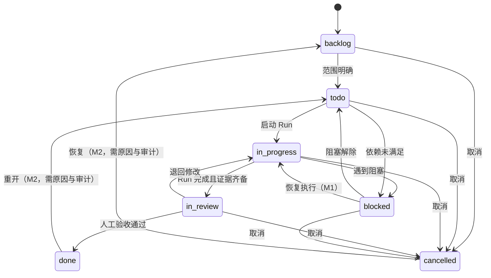

与 `02-domain-model.md` 4.2 的对应关系必须显式说明，避免把本节简化图误读为完整规则：

- `02-domain-model.md` T-10 允许「任意非终态 → cancelled」（守卫：无活跃 Run 或先取消 Run），因此 in_review、blocked 也可以取消；本节图已补齐这些边。
- `02-domain-model.md` T-08/T-09 允许 blocked 回到 todo 或 in_progress（M1）；本节图已包含这两条边。
- `02-domain-model.md` T-11 允许 done → todo 的有审计重开，T-12 允许 cancelled → backlog 的有审计恢复，二者都在 M2 交付，且必须提供原因、记录操作者并写审计；因此 done 与 cancelled 是正常终态，但不是不可恢复的墓碑状态。
- M1 只实现取消（T-10）与受控状态转换；T-11/T-12 属于 M2。M0 的 PATCH 可以任意跳转状态，是已知简化，不能作为流程依据。
- blocked 不是错误，而是可解释的等待；界面必须显示阻塞原因与阻塞来源。

Run 状态机如下。Run 一旦进入 completed、failed、cancelled，就不得回退到运行态；重试必须创建新的 Run，而不是复活旧 Run。

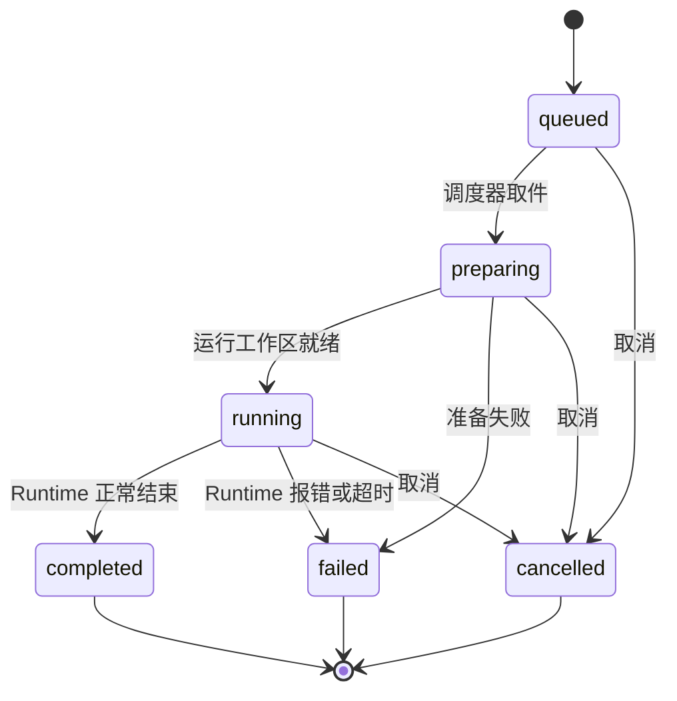

Run 状态机只有 queued、preparing、running、completed、failed、cancelled 六种状态，不存在 `needs_attention`。检查失败、Runner 失联、超时等异常统一用 `failed` + 结构化 errorCode/failureDetail 表达（如 `checks_failed`、`timeout`、`interrupted` + `runner_lost`），不得新增平行状态或分裂状态机（对齐 `02-domain-model.md` 4.3 与 DM-RUN-011）。

流程记号约定：

- 「人类」指发起人、评审者或管理员；「系统」指 ATeam 的 Go core、调度器与事件总线；「Agent」指被 Run 实例化的工作配置。
- 「门」指人工审批节点，未通过则后续步骤不可执行；门不是提示，而是状态约束。
- 「证据」指可复核的交付物：diff、测试输出、构建日志、截图、设计稿、API 契约、部署计划、审计记录。
- 「完成」在 ATeam 中有两个含义：Run completed 只代表一次执行结束；Task done 必须经过人工验收。二者不可混淆。

### 1.5 需求编号约定

本章功能需求使用独占前缀 `FLOW-`，不与 `02-domain-model.md` 的 `DM-` 编号及 `modules/*.md` 的 TASK、AGENT、RUN、SEC、COLLAB、UI、API、NFR 编号共用号段：

| 前缀 | 适用范围 | 号段起点 |
|---|---|---|
| FLOW-X-xxx | 跨流程通用需求（第 3 章） | FLOW-X-001 |
| FLOW-A-xxx | 流程 A | FLOW-A-001 |
| FLOW-B-xxx | 流程 B | FLOW-B-001 |
| FLOW-C-xxx | 流程 C | FLOW-C-001 |
| FLOW-D-xxx | 流程 D | FLOW-D-001 |
| FLOW-E-xxx | 流程 E | FLOW-E-001 |
| FLOW-F-xxx | 流程 F | FLOW-F-001 |
| FLOW-N-xxx | 本章非功能需求 | FLOW-N-001 |

规则：

1. 本章旧版的 TASK-/AGENT-/RUN-/SEC-/COLLAB-/UI-/API-/TEAM-/NFR- 编号已全部停用；引用本章需求时必须使用 FLOW- 编号。旧版 FLOW-A-001～FLOW-A-010 保留并继续使用，本次修订新增 FLOW-A-011～FLOW-A-022。
2. 领域模型与模块文档的 FR 仍是各自领域的权威来源。本章的 FLOW- 需求只描述流程行为，不复制字段级契约；需要引用时应写「见 02-domain-model DM-RUN-006」或「见 modules/runtime-and-workspace.md RUN-080」，不得只写裸编号。
3. `prd/04-acceptance-and-test-plan.md` 3.1 的 FR 前缀表已登记本章的 FLOW- 前缀；验收用例引用本章需求时使用 FLOW- 编号，引用模块需求时写明模块文档名。

## 2. 角色与场景

### 2.1 角色定义

| 角色 | 目标 | 关注流程 | 权限边界 |
|---|---|---|---|
| 独立开发者 | 同时推进 3-5 个 Agent，快速获得可评审产物 | A、B、D、E | 本机全部任务与 Agent；合并、部署需本人确认 |
| 任务发起人 | 把需求变成可执行任务，控制范围与优先级 | A、B、D、E | 创建/编辑任务；发起 Run；不能绕过审批门 |
| 评审者 | 对设计、契约、diff 与证据做独立判断 | B、D | 批准/拒绝/要求修改；不能替发起人合并未授权分支 |
| 团队管理员 | 管理成员、Runner、共享 Agent 与审计 | F | 成员与角色管理；Runner 注册；审计导出 |
| UI Design Agent | 产出设计说明、设计 token、界面截图 | B | 只写设计目录；不修改业务代码 |
| Frontend Agent | 按设计稿与冻结契约实现前端 | B | 只写前端目录；契约文件只读 |
| Backend Agent | 产出 API 契约，并按冻结契约实现服务端与数据层 | B | 只写后端与契约目录；不修改前端实现 |
| DevOps Agent | 产出 staging 部署与验证，编写 prod 计划 | B、D | 只能执行 staging；prod 必须人工执行 |
| 人类集成者（评审者） | 把前后端候选变更合并到集成分支，运行 E2E，提交合并请求（M1 Review+MergeRecord；M2 起另需 Approval） | B、D | 只能写 `ateam/integration/*` 非保护分支；目标/受保护分支合并必须在 G3 后由人类执行 |
| Crew 队长 Agent | 在同一任务内拆解、派发、集成成员结果 | C | 不能合并、不能部署、不能扩预算 |
| Remote Runner | 在远程机器上领取并执行 Run | F | 只执行被分配的 Run；不回传无关文件 |

### 2.2 场景矩阵

| 场景 | 触发 | 使用流程 | 成功标准 | 里程碑 |
|---|---|---|---|---|
| S1 | 开发者有一个明确的小修复 | A | 15 分钟内完成 Run、评审与合并 | M0/M1 |
| S2 | 需求需要先设计再开发 | B | 设计门与契约门通过后，前后端并行完成 | M2.1 |
| S3 | 一个任务需要多个角色回合协作 | C | 队长完成拆解与集成，人类只做关键审批 | M2.2 |
| S4 | 高风险动作需要留痕 | D | 每次合并/部署都有授权/确认人与证据哈希 | M1/M2.1 |
| S5 | Agent 超时、报错或被阻塞 | E | 任务进入明确状态，有人接手 | M0/M1 |
| S6 | 两名开发者共享任务与机器 | F | 远程 Runner 执行，权限与审计正确 | M3 |
| S7 | 定时或 Webhook 触发任务 | 非本章主线 | 默认创建 Task 并进入 Backlog，只有显式 todo 才排队 Run；仍走人工合并门 | M4 |
| S8 | Agent 越权修改路径 | B、D、E | Run 失败，证据保留，任务升级到人 | M2.1 |
| S9 | 需求尚未成形，需要先与不同角色讨论 | G | 小组会话中完成路由或 `@` 讨论，结论一键转任务并可追溯 | M2.3 |
| S10 | 需要判断多个 Agent 的工作状态并复盘某个 Agent 的工作 | H | 看板显示工作状态，点击进入工作页查看上下文与完成过程 | M2.4 |

## 3. 通用流程规则

### 3.1 上下文容器与执行单元的边界

Task 是上下文容器，承载目标、描述、优先级、标签、父任务与指派信息。Agent 是持久配置，承载 instructions、runtime、model、并发、超时、路径与命令边界。Run 是一次执行，必须记录它使用的 Task 版本与 Agent 配置版本。

流程规则如下：

1. Run 创建后，不允许通过修改 Task 来改变该 Run 的 prompt；Task 的新内容只影响下一次 Run。
2. Agent 配置在 Run 启动时应做快照。当前 M0 在调度器执行时才读取 Agent，若在排队期间修改 Agent，会改变本次 Run 的行为；M1 要求把 Agent 配置快照写入 Run，保证可复现。
3. 同一个 Task 可以串行创建多个 Run，但同一时刻最多只能有一个活跃 Run（queued、preparing 或 running）。存在活跃 Run 时重复创建返回 409，并在响应中返回现有 Run，供界面提示「查看正在运行的 Run」；该规则在 M1 生效（FLOW-X-025，对齐 `02-domain-model.md` DM-RUN-006）。M0 的 `createRun` 不检查活跃 Run，重复点击或并发请求可能创建多个 Run，属于已知缺陷。允许的例外只有：Run 已进入终态后重试；M2 起 in_review 的返工必须先通过 changes_requested 回到 in_progress，或创建新 Review 并说明取代旧评审的原因（`02-domain-model.md` 4.2/4.4）。M2 的 Crew 通过子 Task 组织并行，每个子 Task 仍默认单活跃 Run；显式 `parallelRunPolicy=multiple` 属于例外，见流程 C。
4. 同一个运行工作区在同一时刻只能有一个写入者。M0 每次 Run 一个独立目录，天然满足；M2 Crew 若采用共享运行工作区，必须加写锁或改为每成员独立 worktree。
5. Run 结束不自动等于 Task done。Run completed 只表示 Runtime 正常退出，仍需人工查看证据并验收。
6. Run 事件分为两类：Runtime 事件（`run.event`，来自 adapter 的 log/tool/diff 等）与生命周期事件（`run.queued`、`run.preparing`、`run.running`、`run.updated`）。M0 只把 Runtime 事件写入 `run_events`；生命周期事件仅通过 WS 广播。M1 必须把生命周期事件也持久化，或明确声明只广播，并让 `seq` 从数据库中的最大 `seq` 续号，避免重跑时序号重置。

### 3.2 人工审批原则

ATeam 的治理底线是：Agent 可以提议，但不能独立完成高风险动作。以下动作必须由人类在 ATeam 内显式批准：

| 动作 | 是否允许 Agent 自动执行 | 审批要求 | 里程碑 |
|---|---|---|---|
| 修改工作区内的代码 | 允许，受路径与命令边界约束 | 无需逐次审批，但需证据 | M1/M2.1 |
| 创建本地分支与 worktree | 允许 | 无需审批 | M1 |
| 合并到受保护分支 | 禁止 | M1：Review approved + 显式确认 + expectedHeadCommit，记录 MergeRecord；M2 起另需 Approval | M1/M2 |
| push 到远端 | 禁止 | 人工审批；M1 不适用（本地闭环无远程推送），M2 起启用，M3 走 GitHub PR | M2/M3 |
| 部署 staging | 仅 DevOps Agent 可提议并执行 | staging 审批 | M2.1 |
| 部署 prod | 禁止 | 人工执行，Agent 只产出计划 | M2.1 |
| 删除 Task、Agent、Workspace | 禁止自动执行 | 人工确认；团队模式还需角色权限与审计 | M1/M3 |
| 修改权限、成员、Runner | 禁止 | 管理员操作并审计 | M3 |

M1 只强制本地合并确认（Review approved + 显式确认 + MergeRecord）与删除确认；Approval 实体从 M2 起引入。远程 push 的审批从 M2 起（与 `01-scope-and-roadmap.md` 11.1/11.2 的高风险审批矩阵一致），GitHub PR 属于 M3。M1 未配置远程仓库时，push 入口不可用，而不是展示一个可绕过的审批占位。

M0 的现状是：prompt 中写了「Do not push, merge, or deploy without explicit human approval」，但这只是提示，不是强制。M1 必须把本地合并变成「Review approved + 显式确认 + MergeRecord」的系统动作，并把删除变成需要确认与审计的动作；M2.1 必须把路径与命令边界变成运行时约束，引入 Approval，并把 push、staging、prod 纳入审批。

### 3.3 证据化完成定义

「证据化 DoD」指：任何被标记为可评审或可合并的 Run，必须附带一组可复核证据。不同类型任务的必需证据不同，但都必须可定位、可下载、可追溯到 Run。

本节是流程级摘要。证据类型、字段、哈希算法、脱敏与保留策略的权威定义见 `modules/collaboration-and-review.md`（证据化 DoD 与 Review）与 `modules/runtime-and-workspace.md`（Artifact/Evidence 采集）；合并/审批记录字段见 `02-domain-model.md` 3.11、3.15 与 4.6。下表只说明每条流程最少需要什么证据，不重复字段级定义。

| 证据类型 | 内容 | 产生者 | 最低要求 | 里程碑 |
|---|---|---|---|---|
| Diff | 变更文件列表与逐行差异 | 运行工作区 | 必须能按文件查看与折叠 | M1 |
| Test Report | 单元/集成/E2E 测试命令与结果 | Runtime 或项目脚本 | 必须包含退出码与失败用例 | M1 |
| Build Log | 构建输出与产物信息 | Runtime | 失败时必须保留日志 | M1 |
| Screenshot | 关键界面截图 | Runtime 或前端工具 | 至少覆盖主路径（M2 起） | M1 可选 / M2 必需 |
| Design Spec | 设计说明、组件状态、token | UI Design Agent | 含版本与验收清单 | M2.1 |
| API Contract | OpenAPI 文档、错误码、示例 | Backend Agent（契约子任务） | 含版本与兼容性说明 | M2.1 |
| Deploy Plan | 环境、步骤、回滚、验证 | DevOps Agent | prod 计划必须人工执行 | M2.1 |
| 评审/合并记录 | M1：Review、MergeRecord（操作者、expectedHeadCommit、结果）；M2：Approval（审批人、actionFingerprint、consumedAt） | 系统 | 不可篡改、可导出 | M1/M2/M3 |

规则：

- 缺少必需证据时，评审按钮应禁用并显示缺口，而不是允许「先合并后补」。
- 证据必须绑定 Run ID 与证据哈希。Run 重跑后，旧证据保留但标记为历史版本。
- 证据变化不等于审批状态自动变成 expired。M2 的 Approval 绑定 `actionFingerprint`；新增提交、diff 变化、契约升级或测试重跑导致指纹不匹配时，执行动作返回 412，审批保持 `approved` 但不可消费，必须重新审批（`02-domain-model.md` 4.6、DM-APPR-003）。M1 没有 Approval 实体，合并门使用 Review approved + 显式确认 + `expectedHeadCommit`/证据快照校验，变化时返回 412（`02-domain-model.md` DM-MRG-003）。`expired` 只表示超过 `expiresAt` 或批准后的消费窗口。

### 3.4 通用功能需求

以下需求适用于所有流程，编号在后续流程中引用。旧版这些条目使用 TASK-/AGENT-/RUN-/SEC- 前缀，与领域模型和模块文档冲突，现已统一改为 `FLOW-X-` 号段。

| 编号 | 需求 | 验收标准 | 里程碑 | 状态 |
|---|---|---|---|---|
| FLOW-X-001 | 创建任务必须提供非空标题；未提供状态时默认 backlog | 空标题返回 400；缺省状态落库为 backlog | M0 | 已实现（M0） |
| FLOW-X-002 | 任务状态只允许 backlog、todo、in_progress、in_review、done、blocked、cancelled | 非法状态返回 400，且不落库 | M0 | 已实现（M0；M1 起转换受 02-domain-model 4.2 约束） |
| FLOW-X-003 | M0 允许 todo、in_progress、in_review 发起 Run；M1 起只允许 todo、in_progress，in_review 需先 changes_requested 回到 in_progress | 其他状态发起 Run 返回 409；界面按钮禁用并说明原因 | M0/M1 | 部分实现（M0：现有 `TaskStatus.Executable()` 允许三者；M1 收紧并区分原因） |
| FLOW-X-004 | 任务详情必须展示优先级、标签、父任务、指派人 | 详情页可见全部字段；字段为空时有明确空态 | M1 | 计划（M1） |
| FLOW-X-005 | Run 完成且证据齐备时，系统可创建 pending Review 并把任务置为 in_review；证据不齐时只提示提交评审；任何情况下不得自动置为 done | 完成 Run 后任务进入 in_review 或显示「提交评审」；done 只能由人工 Review approve（需要合并时还需 MergeRecord 成功）进入 | M1 | 计划（M1；决策来源 02-domain-model 4.4/4.5） |
| FLOW-X-006 | 存在活动 Run 的任务不得删除 | 删除请求返回 409；需先取消或等待 Run 结束 | M1 | 计划（M1） |
| FLOW-X-007 | 子任务全部完成且集成步骤通过后，父任务才可进入 done | 父任务验收门检查子任务状态与集成证据 | M2.1 | 计划（M2.1） |
| FLOW-X-008 | 创建 Agent 时 runtime 默认 mock，workspaceMode 默认 worktree，maxConcurrency 默认 1，timeoutMinutes 默认 60 | 省略对应字段创建后，返回值符合默认值 | M0 | 已实现（M0） |
| FLOW-X-009 | 未知 runtime 不得静默回退到 mock | 保存时校验 runtime 是否已注册；未知值返回 400 并提示 | M1 | 计划（M1） |
| FLOW-X-047 | Agent 的 model 为空表示 Runtime 默认；非空必须命中所选 Runtime 的本地模型目录；目录包含 Runtime 探测、Claude 本地配置（modelPicker / ANTHROPIC_*_MODEL）与 ATeam 本地配置；表单使用下拉选择，不提供自由文本；未知模型返回 400 `MODEL_NOT_AVAILABLE`；Runtime 列表包含本机检测到的 harness CLI，未实现适配器的标记为暂不支持 | 下拉选项与目录一致；空目录只显示默认项与配置入口；切换 Runtime 后无残留无效模型；不支持的 Runtime 不可选 | M2.1 | 计划（M2.1） |
| FLOW-X-048 | Agent 支持编辑与删除；编辑预填并 PATCH，删除前二次确认且活跃 Run 阻止删除；创建/编辑可选择 Runtime 与模型后测试连接，测试为一次最小只读请求，不创建 Run | 编辑保存后卡片更新；删除 409 可读；测试成功显示耗时，失败显示原因且不阻塞保存 | M2.1 | 计划（M2.1） |
| FLOW-X-010 | 每个 Run 必须快照其 Agent 配置 | Run 详情可查看创建时的 instructions、runtime、model、timeout 与权限 | M1 | 计划（M1） |
| FLOW-X-011 | 提供 UI Design、Frontend、Backend、DevOps 四个角色模板 | 模板可一键创建 Agent，含默认 instructions、路径与证据要求；不提供 API Contract 与 Integration 模板 | M2.1 | 计划（M2.1） |
| FLOW-X-012 | Agent 的 allowedPaths 与 allowedCommands 必须被强制执行 | 越界写入或越界命令导致 Run 失败并保留违规证据 | M2.1 | 计划（M2.1） |
| FLOW-X-013 | 创建 Run 必须指定 agentId；Run 初始状态为 queued | 缺少 agentId 返回 400；创建成功后广播 run.queued | M0 | 已实现（M0） |
| FLOW-X-014 | Run 状态只能按状态机前进，终态不可回退 | 尝试把 completed 改回 running 被拒绝 | M0 | 部分实现（M0：缺少显式转换守卫，取消与完成竞态可覆盖终态） |
| FLOW-X-015 | Runtime 事件必须持久化并带单调递增 seq；生命周期事件也必须可回放 | 重载页面后可按 seq 回放；WS 事件类型为 run.event | M0/M1 | 部分实现（M0：仅 adapter 的 Runtime 事件写入 run_events；run.preparing/run.running/run.updated 只广播；seq 为每次 execute 的局部计数器，从 0 起，重跑会重置。M1 补齐生命周期事件持久化，seq 从数据库最大 seq 续号） |
| FLOW-X-016 | 取消对终态 Run 必须幂等 | 对 completed/failed/cancelled 再次取消返回 200 且不改变状态 | M0 | 已实现（M0） |
| FLOW-X-017 | Agent 的 timeoutMinutes 必须生效 | 超时后 Run 进入 failed，错误码为 timeout，错误信息包含超时原因 | M0/M1 | 部分实现（M0：context 超时能终止直接子进程；claude adapter 通常只返回 signal: killed，scheduler 未把 DeadlineExceeded 映射为 timeout，错误文本不保证包含原因。M1 补 errorCode 与最后事件） |
| FLOW-X-018 | Run 必须在独立 git worktree 与独立分支中执行 | Run 详情包含 branch 与 worktree；不同 Run 互不覆盖 | M1 | 计划（M1） |
| FLOW-X-019 | 重试必须创建新 Run 并记录 retryOf 与 attempt 指向原 Run | 重试链可追溯；原 Run 不被修改 | M1 | 计划（M1） |
| FLOW-X-020 | 可评审 Run 必须提供 diff 与测试证据 | 评审页可查看 diff、测试输出；M1 的 screenshot Artifact 若存在可查看但不作为 DoD 必需，M2 起 UI 类任务必需截图 | M1/M2 | 计划（M1；M2 增加截图 DoD） |
| FLOW-X-021 | 服务重启后不得静默丢失 preparing/running 的 Run | 启动后 10 秒内标记为 failed，errorCode=interrupted、failureDetail=app_restart，并提示重试；queued Run 有明确归宿 | M1 | 计划（M1） |
| FLOW-X-022 | 结构化流式事件必须区分 log、tool、file、diff、test、summary、error | 前端可按类型过滤；未知类型不影响展示 | M1 | 计划（M1） |
| FLOW-X-023 | Agent 级 maxConcurrency 必须被调度器执行 | 同一 Agent 的并发 Run 数不超过配置值 | M2 | 计划（M2；对齐 02-domain-model DM-AGENT-010） |
| FLOW-X-024 | Run.trigger 使用六值枚举：manual、retry、schedule、webhook、dependency、crew；M1 只产生 manual/retry，M2 增加 dependency/crew，M4 增加 schedule/webhook | Run 记录 trigger；不出现第七值；自动触发仍需人工合并门 | M4 | 计划（M4） |
| FLOW-X-025 | 同一 Task 同时最多一个活跃 Run；重复创建返回 409 并返回现有 Run | 并发点击 Run 只产生一个 Run；409 响应携带现有 Run ID | M1 | 计划（M1；对齐 02-domain-model DM-RUN-006） |

### 3.5 交互与通用规则

以下规则适用于所有流程。旧版把它们写成无编号段落，无法在验收中追踪；现改为有编号需求，并明确 M0 现状与目标里程碑。

| 编号 | 规则 | 验收标准 | 里程碑 | 状态 |
|---|---|---|---|---|
| FLOW-X-026 | 所有会造成状态变化的按钮必须有「不可用原因」：任务状态不允许、未选择 Agent、缺少权限、存在活动 Run 等 | 只禁用不解释视为缺陷；每个禁用态有具体原因文本 | M0/M1 | 部分实现（M0：任务状态与未选 Agent 有通用提示；Agent 不可用、活动 Run、权限原因未区分） |
| FLOW-X-027 | 列表页必须在数据变化后 2 秒内反映新状态 | WS 正常时 2 秒内刷新；断线时轮询兜底 | M0 | 部分实现（M0：WS 触发拉取 + 任务详情 1.5 秒轮询；列表页无轮询兜底） |
| FLOW-X-028 | 任何长操作都必须可离开页面 | 离开任务详情后 Run 继续执行；重新进入可恢复查看 | M0 | 已实现（M0） |
| FLOW-X-029 | 错误必须区分「请求失败」「运行失败」「证据缺失」「权限不足」四类 | 四类错误有不同文案与下一步动作，不显示为未知错误 | M1 | 计划（M1；M0 未分类） |
| FLOW-X-030 | 同一实体在 Board、Task 详情、Runs 列表中的状态与时间必须一致 | 以服务端为准；前端不做乐观终态 | M0 | 部分实现（M0：均以服务端数据为准，但缺少跨视图一致性测试） |

### 3.6 数据与 API 影响

流程依赖以下现有资源与事件。M1-M3 只允许扩展，不允许破坏 M0 的路径语义：

| 资源/事件 | 现有能力 | 流程使用方式 | 后续扩展 |
|---|---|---|---|
| `/api/v1/workspaces`（M1 新增；`/api/v1/projects` 为兼容别名） | 无；M0 只有隐式默认 Workspace | 流程 A/B/F 的 Workspace 归属与归档 | M1 提供 Workspace CRUD 与归档；M3 增加成员权限 |
| `/api/tasks` 与 `/api/tasks/{id}` | CRUD 与状态校验（M0 路径，兼容期保留） | 流程 A/B/C/F 的上下文容器 | M1 响应增加 `workspaceId`、`revision`；新接口用 `/api/v1`；M2.1 增加依赖关系与交付物契约字段 |
| `/api/agents` 与 `/api/agents/{id}` | CRUD、默认值（M0 路径） | 流程 A/B 的工作配置 | M2.1 增加角色模板与权限字段 |
| `/api/tasks/{id}/runs` | 创建与列出 Run；M0 不检查活跃 Run | 流程 A/E 的执行入口 | M1 增加单活跃 Run 409、幂等键；M4 增加 trigger 来源 |
| `/api/runs/{id}/events` | 回放 `run_events`（M0 仅 Runtime 事件） | 流程 A/E 的日志与审计 | M1 增加生命周期事件与 seq 续号 |
| `/api/runs/{id}/cancel` | 取消 Run；对终态幂等 | 流程 E | M1 修复排队与准备阶段取消竞态 |
| `/api/v1/runs/{id}/reviews`（M1 新增） | 无 | 流程 A/B/D 的评审 | M1 提供 Review 创建、决定与评论；M2 支持多 Run 聚合 |
| `/api/v1/runs/{id}/merge`（M1 新增） | 无；M0 无合并能力 | 流程 A/B 的合并门 | M1 创建 MergeRecord，校验 Review、expectedHeadCommit、证据快照；不创建 Approval |
| `/api/v1/approvals`（M2 新增） | 无 | 流程 D 的 Approval | M2 提供请求、决定、撤回、查询与消费 |
| `/api/ws` | task/agent/run 事件广播；生命周期事件不落库 | 所有流程的实时刷新 | M1 事件持久化补齐；M3 增加团队与 Runner 事件 |

API 通用约定：错误响应为 `{"error": "..."}`；创建成功返回 201；无内容删除返回 204；Run 事件只追加不修改；前端不得依赖事件顺序以外的隐式状态。M1 新增接口统一使用 `/api/v1` 前缀，M0 路径在兼容期继续可用；`expectedHeadCommit`、证据快照或 M2 审批指纹不匹配返回 412（`02-domain-model.md` 9.9）。

### 3.7 权限与安全通用要求

里程碑拆分：M1 只强制本地合并确认（Review + MergeRecord）与删除确认；push、staging、prod 从 M2 起纳入审批（Approval）；团队审计与四眼原则从 M3 起。路径与命令策略的字段级定义见 `modules/security-and-permissions.md`，本节只保留流程级约束。

| 编号 | 需求 | 验收标准 | 里程碑 | 状态 |
|---|---|---|---|---|
| FLOW-X-031 | 合并、push、部署、删除必须有人工授权或确认记录 | 缺少记录时动作被拒绝；审计可见操作者与目标 | M1/M2/M3 | 计划（M1：合并用 Review+MergeRecord，删除需确认；M2 起 Approval） |
| FLOW-X-032 | M1 MergeRecord 必须记录操作者、时间、Review、expectedHeadCommit、证据快照与结果；M2 Approval 必须记录 actionFingerprint、决定与 consumedAt/consumedBy | 记录字段完整且可导出；M1 每条合并尝试有记录，M2 审批消费后可追溯 | M1/M2 | 计划（M1/M2） |
| FLOW-X-033 | 证据或目标变化必须使授权/确认不可用 | M1 expectedHeadCommit 或证据快照变化返回 412；M2 Approval 指纹不匹配返回 412，审批不可消费 | M1/M2 | 计划（M1/M2） |
| FLOW-X-034 | prod 部署必须由人类执行，Agent 只能产出计划 | DevOps Agent 的 prod 执行请求被拒绝并记录 | M2 | 计划（M2） |
| FLOW-X-035 | 本地模式默认只监听 127.0.0.1，且不假设有登录 | 默认绑定地址为回环地址；远程访问需显式配置 | M0 | 已实现（M0） |
| FLOW-X-036 | 事件、日志与证据不得写入密钥明文 | 常见密钥模式被脱敏；导出文件不包含明文密钥 | M2 | 计划（M2） |
| FLOW-X-037 | 团队模式所有高风险动作必须写入审计日志 | 审计可按人、任务、时间检索 | M3 | 计划（M3） |
| FLOW-X-038 | 路径与命令 allowlist 必须在运行时强制执行 | 越界行为被阻断，Run 失败并给出违规路径 | M2.1 | 计划（M2.1） |
| FLOW-X-039 | 团队模式下合并到受保护分支必须四眼原则 | 发起 Run 的人不能单独批准自己的合并 | M3 | 计划（M3） |

### 3.8 删除与归档的跨流程规则

删除和归档是高风险动作，但此前只在 3.2 用一行审批规则带过，缺少步骤、影响面、清理责任与异常路径。本节补齐 Task、Agent、Workspace 三类对象的用户流程。字段、软删除保留窗口与恢复规则的权威定义见 `02-domain-model.md` 7.3 与 `modules/task-management.md`、`modules/agent-system.md`、`modules/security-and-permissions.md`。

#### 3.8.1 统一步骤

1. 用户从 Task 详情、Agents 列表或 Workspace 设置触发删除/归档。
2. 系统先做影响面检查：活跃 Run、未关闭 Review、子任务、引用该 Agent 的排队 Run、Workspace 下的任务与证据数量。
3. 有活跃引用时拒绝删除并返回 409，列出阻塞项；用户必须先取消、等待或改派，或改为归档。
4. 无阻塞时，系统展示影响面摘要并要求二次确认；M3 团队模式下还需要对应 Workspace 角色权限（workspace_admin 及以上）与审批记录。
5. 确认后执行归档；只有满足「无 Run、无 Artifact、无 Review、无 Approval 引用」时才允许硬删除。归档写入领域事件；硬删除前按保留策略处理 Artifact 与事件。
6. 归档对象可恢复；硬删除不可恢复。Workspace 删除默认保留 90 天后再清理。

#### 3.8.2 对象差异

| 对象 | 删除/归档前提 | 数据保留 | 里程碑 | 清理责任 |
|---|---|---|---|---|
| Task | 无活跃 Run、无未关闭 Review；M1 通过确认后归档，不提供硬删除 | 归档保留全部 Run、Artifact 与事件；默认列表隐藏；M2.1 起 30 天恢复窗口 | M1 归档与删除保护 | 系统；证据按保留策略 |
| Agent | 无活跃 Run、无未关闭 Review；M1 通过确认后归档，不提供硬删除 | 历史 Run 保留 Agent 版本快照；不可再被选择；M2.1 起 30 天恢复窗口 | M1 归档与删除保护 / M2.1 恢复 | 系统 |
| Workspace | 无活跃 Run；删除需 M3 Approval 并导出审计摘要 | 归档后任务、Agent、Run 只读；删除默认保留 90 天 | M1 归档 / M3 删除 | Owner/Admin |

Run Workspace（运行工作区）不通过用户删除入口管理：合并或放弃后默认保留 30 天，未合并且有改动的 worktree 不得自动删除；Artifact 与事件默认保留 90 天（`02-domain-model.md` DM-RUN-014）。清理失败进入告警，不静默丢弃。

#### 3.8.3 异常与验收

| 异常 | 系统行为 | 用户可见结果 | 里程碑 |
|---|---|---|---|
| 删除有活跃 Run 的 Task | 返回 409，列出活跃 Run | 提示先取消或等待 | M1 |
| 删除被排队 Run 引用的 Agent | 返回 409 或使排队 Run 以明确错误失败 | 提示改派或取消 Run | M1 |
| 删除有未关闭 Review 的 Task | 返回 409 | 提示先关闭 Review | M1 |
| 归档对象恢复 | 恢复对象与关联数据，写事件 | 列表重新出现 | M1/M2 |
| 清理任务失败 | 保留 tombstone，重试并告警 | 不影响列表；管理员可见告警 | M3 |
| 跨 Workspace 删除 | 不可见资源返回 404，可见但权限不足返回 403，并写审计 | 提示无权限 | M3 |

| 编号 | 需求 | 验收标准 | 里程碑 | 状态 |
|---|---|---|---|---|
| FLOW-X-040 | 删除 Task 前必须没有活跃 Run 与未关闭 Review | 违反返回 409 并列出阻塞项 | M1 | 计划（M1） |
| FLOW-X-041 | 删除 Agent 前必须没有活跃或排队 Run 引用 | 违反返回 409；历史 Run 保留版本快照 | M1 | 计划（M1） |
| FLOW-X-042 | 删除 Workspace 必须经过审批并导出审计摘要 | 缺少审批时返回 403；导出包含对象清单 | M3 | 计划（M3） |
| FLOW-X-043 | 删除/归档必须展示影响面并二次确认 | 确认框列出对象、数量、不可逆项与保留窗口 | M1 | 计划（M1） |
| FLOW-X-044 | 归档对象必须可恢复 | 恢复后关联数据可见；恢复动作留痕 | M1/M2 | 计划（M1/M2） |
| FLOW-X-045 | 清理任务必须可重试且不静默丢失 tombstone | 清理失败有告警；重试后完成物理删除；Workspace 默认保留 90 天 | M3 | 计划（M3） |
| FLOW-X-046 | 团队模式删除必须受角色权限约束并写审计 | 越权返回 403；审计可按对象检索 | M3 | 计划（M3） |

## 4. 流程 A：单人 + 单 Agent 的本地闭环

### 4.1 目的与范围

流程 A 是 ATeam 的最小可用闭环：一个开发者在本机创建一个 Task，选择一个 Agent，启动 Run，观察日志，评审 diff，合并并结束任务。它验证三件事：上下文能正确传递给 Runtime；执行过程可观察、可取消；产物能被人类评审并安全合并。

M0 已经实现「任务创建 → Agent 选择 → Run 调度 → 事件日志 → 取消」的机制，但运行工作区目前只是每次 Run 一个普通目录，不是项目仓库的 git worktree；Claude adapter 也只是最小实现。因此 M0 可以演示闭环，但不能真实完成「改代码 → 看 diff → 合并」。真实本地闭环属于 M1。

### 4.2 前置条件

| 条件 | 说明 | 当前状态 |
|---|---|---|
| 已启动 ATeam 服务或桌面壳 | `ateam serve` 默认监听 127.0.0.1:8787；桌面壳使用随机本地端口 | 已实现（M0） |
| 已有一个项目仓库 | M1 要求是 git 仓库且工作区干净或可安全创建 worktree | 计划（M1） |
| 已创建至少一个 Agent | Agent 指定 runtime、instructions、超时与路径边界 | 已实现（M0） |
| Runtime 可用 | mock 无需外部依赖；Claude Code 需要本机 CLI 已安装并完成登录 | 部分实现（M0 最小 adapter） |
| 任务处于可执行状态 | M0 为 todo、in_progress、in_review；M1 起为 todo、in_progress（in_review 需先 changes_requested） | 部分实现（M0；M1 收紧） |
| 人类在场 | 合并与验收必须由人完成 | 设计约束 |

### 4.3 主流程

#### 4.3.1 流程图

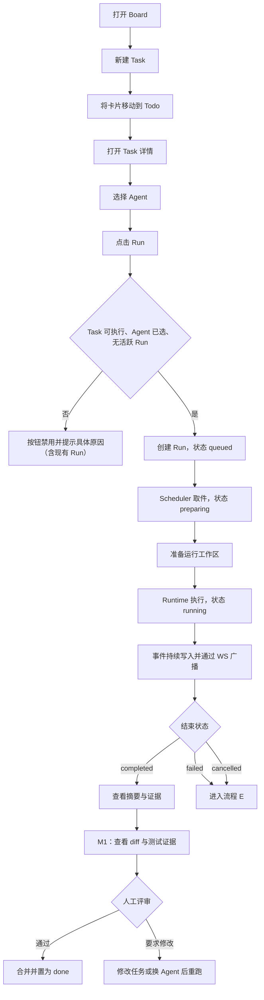

#### 4.3.2 步骤说明

| 步骤 | 操作者 | 动作 | 系统行为 | 输出/交付物 | 里程碑 |
|---|---|---|---|---|---|
| A1 | 人类 | 打开 Board | 拉取任务列表并按五列分组显示 | Board 视图 | 已实现（M0） |
| A2 | 人类 | 点击 New task，填写标题、描述、状态 | 校验标题非空；默认状态 backlog；创建成功后广播 task.created | Task 记录 | 已实现（M0） |
| A3 | 人类 | 将卡片拖到 Todo，或直接以 Todo 创建 | PATCH 任务状态；M0 未处理接口失败，M1 要求失败时回滚并提示（FLOW-A-015） | 状态为 todo | 部分实现（M0：成功路径可用；失败提示为 M1） |
| A4 | 人类 | 点击卡片进入详情 | 加载 Task、该 Task 的 Runs 与 Agent 列表；默认选中第一个 Agent | Task 详情页 | 已实现（M0） |
| A5 | 人类 | 选择 Agent | 展示 Agent 名称与 runtime；不可用 Agent 需提示原因 | 选中的 Agent | 部分实现（M0：列出全部 Agent，不区分可用性；不可用原因提示属于 M1） |
| A6 | 人类 | 点击 Run | 前端校验状态与 Agent；服务端再次校验；创建 queued Run；把 Task 指派给该 Agent；todo 自动转 in_progress；广播 run.queued；异步入队 | Run 记录 | 部分实现（M0：主路径可用；未检查同一 Task 的活跃 Run，重复点击可能创建多个 Run，M1 增加 409） |
| A7 | 系统 | 调度器取件 | 加载 Task、Agent；再次校验任务状态；置 preparing；创建运行工作区目录；广播 run.preparing（M0 不写入 run_events） | 工作目录 | 已实现（M0，目录而非 worktree；生命周期事件仅广播） |
| A8 | 系统 | 启动 Runtime | 置 running；应用 timeoutMinutes；调用 mock 或 claude adapter；逐条持久化 Runtime 事件并广播；状态更新通过 run.updated 广播 | 日志事件 | 已实现（M0：Runtime 事件持久化；生命周期事件不落库） |
| A9 | 人类 | 观察日志 | 任务详情对活动 Run 每 1.5 秒刷新；WS 事件触发列表刷新；日志按 seq 展示 | 可读事件流 | 已实现（M0） |
| A10 | 系统 | 结束 Run | 正常返回置 completed 并写 summary；错误置 failed 并写 error；取消置 cancelled；广播 run.updated | 终态 Run | 已实现（M0；超时未映射 errorCode 的缺口见 FLOW-X-017） |
| A11 | 人类 | 评审产物 | M1：查看 diff、测试报告；screenshot Artifact 若存在可查看；M2 起截图作为 UI 类 DoD 必需；可批准、要求修改或拒绝 | 评审记录 | 计划（M1/M2） |
| A12 | 人类 | 合并并验收 | M1：Review approved 后显式确认合并，写 MergeRecord；Task 置 done；归档 worktree | 合并提交与完成记录 | 计划（M1） |

### 4.4 用户故事

| 编号 | Given/When/Then |
|---|---|
| US-A-01 | Given 我已创建一个 Todo 任务且有一个可用 Agent，When 我在任务页点击 Run，Then 系统创建一个 queued Run，任务进入 in_progress，并在 2 秒内显示 preparing 或 running。 |
| US-A-02 | Given 一个 Run 正在运行，When 我停留在任务页，Then 我能看到持续更新的日志事件，并且刷新页面后仍能回到同一 Run 的完整日志。 |
| US-A-03 | Given 一个 Run 处于 queued、preparing 或 running，When 我点击取消，Then Run 在可接受时间内进入 cancelled，且不再产生新的执行事件。 |
| US-A-04 | Given 一个 Run 已完成并附带 diff 与测试证据，When 我作为评审者查看证据并批准合并，Then 系统记录 Review 结论、合并操作者、expectedHeadCommit 与证据快照哈希，并允许人类显式确认后执行合并；M2 起另记录 actionFingerprint。 |
| US-A-05 | Given 一个 Run 因运行时缺失失败，When 我修复本机环境并点击重试，Then 系统创建一个新的 Run，原 Run 保持 failed 且可作为历史查看。 |

### 4.5 功能需求

| 编号 | 需求 | 验收标准 | 里程碑 | 状态 |
|---|---|---|---|---|
| FLOW-A-001 | Run 按钮必须同时满足任务可执行、Agent 已选、无活跃 Run 三个条件 | 条件不满足时按钮禁用并显示具体原因（哪一项不满足） | M0/M1 | 部分实现（M0：任务状态与未选 Agent 有通用提示；活跃 Run 检查与逐项原因属于 M1） |
| FLOW-A-002 | 创建 Run 时自动把 Todo 任务转为 in_progress，并记录 assigneeType=agent、assigneeId | 任务数据中 assigneeType/assigneeId 与 Run 的 Agent 一致；todo 变为 in_progress | M0 | 已实现（M0，数据行为） |
| FLOW-A-003 | 任务详情必须展示该任务的全部历史 Run，按创建时间倒序 | 多个 Run 可切换查看；终态 Run 不被新 Run 覆盖 | M0 | 已实现（M0） |
| FLOW-A-004 | Run 详情必须支持从持久化事件恢复日志 | 关闭页面再打开，Runtime 事件内容与顺序一致；生命周期事件在 M1 补齐后同样可回放 | M0/M1 | 部分实现（M0：仅 Runtime 事件可回放；生命周期事件只广播） |
| FLOW-A-005 | 运行中离开任务页不应中断 Run | 返回 Board 后 Run 继续；重新进入可看到最新状态 | M0 | 已实现（M0） |
| FLOW-A-006 | M1 必须在项目仓库的独立 worktree 中执行，并创建独立分支 | Run 记录 branch 与 worktree；分支命名可追溯到 Run | M1 | 计划（M1） |
| FLOW-A-007 | M1 必须提供 diff 评审视图与证据清单 | 可按文件查看 diff；缺少测试证据时合并按钮禁用 | M1 | 计划（M1） |
| FLOW-A-008 | M1 必须提供「重试」操作并记录 retryOf | 重试生成新 Run；原 Run 不变；UI 显示重试链 | M1 | 计划（M1） |
| FLOW-A-009 | M1 必须修复排队 Run 的取消语义 | 取消 queued Run 后，调度器不得再执行该 Run | M1 | 计划（M1） |
| FLOW-A-010 | M1 必须支持 Agent 配置快照，避免排队期间配置漂移 | Run 详情展示快照版本；修改 Agent 不影响已排队 Run | M1 | 计划（M1） |
| FLOW-A-011 | 流程 A 的 Run 入口必须执行 FLOW-X-025 的单活跃 Run 规则 | 存在 queued/preparing/running Run 时，Run 按钮禁用；强行请求返回 409 并提示查看现有 Run | M1 | 计划（M1） |
| FLOW-A-012 | 任务详情必须显示当前指派人（人类或 Agent） | 详情头部或属性区显示 assigneeType 与 assigneeId 对应的名称；为空时显示「未指派」 | M1 | 计划（M1；与 FLOW-X-004 一致） |

### 4.6 交互与规则

以下规则对应流程 A 的界面行为。旧版把规则写成无编号段落，并把部分计划行为写成现状；现改为有编号需求，并逐条标注 M0 实现程度。

| 编号 | 规则 | 验收标准 | 里程碑 | 状态 |
|---|---|---|---|---|
| FLOW-A-013 | Board 是入口而不是执行页；点击卡片进入任务详情，所有 Run 操作在详情页完成 | 卡片上不提供 Run/取消等执行操作，避免误触 | M0 | 已实现（M0） |
| FLOW-A-014 | 新建任务弹窗只要求标题；描述、状态可选；创建成功后立即出现在对应列 | 创建不阻塞用户继续创建；空标题不提交 | M0 | 已实现（M0） |
| FLOW-A-015 | 拖动改变状态时，前端等待服务端成功再确认；失败时卡片回到原列并提示 | 接口失败时展示错误，不静默吞掉 | M1 | 未实现（M0：`BoardView.vue` 的 `drop` 直接调用更新，无错误处理；M1 补齐） |
| FLOW-A-016 | 任务详情头部显示状态选择器，包含全部七种状态 | blocked 与 cancelled 可从界面选择；非法转换有原因提示 | M1 | 部分实现（M0：选择器只覆盖五状态，blocked/cancelled 入口缺失） |
| FLOW-A-017 | Run 列表展示状态、触发方式、创建时间、摘要或错误；点击切换日志 | 活动 Run 有明确视觉标识；切换不丢日志 | M0 | 已实现（M0） |
| FLOW-A-018 | 日志面板按 `[类型] 消息` 展示；M1 改为结构化渲染 | 支持按 log、tool、file、diff、test 过滤；未知类型可降级展示 | M1 | 部分实现（M0：纯文本 `[type] message`；结构化渲染为 M1） |
| FLOW-A-019 | 取消按钮只对 queued、preparing、running 显示，点击后二次确认并说明影响 | 确认框说明将终止执行与工作区保留策略 | M1 | 未实现（M0：`TaskView.vue` 的 `cancelRun` 直接调用 API，无二次确认；modules/ui-ux.md UI-021 为 M1 要求） |
| FLOW-A-020 | M1 的评审区采用「证据在上、决定在下」 | 先看 diff 与测试，再出现批准/要求修改/拒绝三个动作 | M1 | 计划（M1） |
| FLOW-A-021 | 所有时间使用本地时区展示，服务端存储 UTC | 相对时间与绝对时间同时可用 | M0 | 已实现（M0） |
| FLOW-A-022 | 空态必须给出下一步：没有任务时提示创建；没有 Agent 时提示先创建 Agent；没有 Run 时提示选择 Agent 并运行 | 每个空态有可点击的下一步入口或明确指引 | M1 | 部分实现（M0：任务与 Run 空态有提示；无 Agent 时仅显示空 select，没有「先创建 Agent」提示） |

### 4.7 交付物

| 交付物 | 内容 | 产生时机 | 里程碑 |
|---|---|---|---|
| Task 记录 | 标题、描述、状态、优先级、指派、标签、父子关系 | 创建与更新时 | M0 |
| Run 记录 | 状态、trigger、attempt、branch、worktree、summary、errorCode、failureDetail、error、时间戳 | Run 生命周期 | M0（基础）/M1（分类） |
| RunEvent 日志 | Runtime 事件：seq、类型、消息、payload、时间（M0）；生命周期事件回放（M1） | 执行过程中 | M0 Runtime 事件、M1 生命周期事件 |
| 运行工作区（Run Workspace） | 本次 Run 的隔离目录或 worktree | preparing 阶段 | M0 目录、M1 worktree |
| Diff 与测试证据 | 文件差异、命令、退出码、失败用例 | Run 结束 | M1 |
| 评审与合并记录 | M1：Review、MergeRecord（操作者、expectedHeadCommit、结果、证据快照）；M2：Approval（actionFingerprint、consumedAt/consumedBy） | 评审与执行时 | M1/M2 |
| 合并结果 | 合并提交、目标分支、执行人 | 合并时 | M1 |

### 4.8 异常与边界

| 异常 | 触发条件 | 系统行为 | 用户可见结果 | 里程碑 |
|---|---|---|---|---|
| 标题为空 | 创建任务未填标题 | 返回 400，不创建 | 表单内联错误 | M0 |
| 任务状态不可执行 | backlog、done、blocked、cancelled，以及 M1 起的 in_review 发起 Run | 后端返回 409；前端预先禁用；in_review 提示先退回 in_progress | 提示正确状态与下一步 | M0/M1 |
| 未选择 Agent | 点击 Run 时 Agent 为空 | 前端阻止请求 | 提示选择 Agent | M0 |
| 已有活跃 Run | 同一 Task 已有 queued/preparing/running Run，用户再次点击 Run 或并发请求 | M1 起后端返回 409 并返回现有 Run；前端禁用并显示「查看正在运行的 Run」 | 提示现有 Run；不创建第二个 Run | M1（M0 未检查） |
| Agent 不存在 | 请求携带已删除的 agentId | 返回 404 | 提示 Agent 不存在并刷新列表 | M0 |
| Runtime 缺失 | Claude CLI 不在 PATH | Run 进入 failed，错误写入 Run | 日志展示可诊断错误 | M0 |
| Runtime 非零退出 | CLI 报错或任务失败 | Run failed，保留 stdout/stderr 事件 | 错误摘要与日志 | M0 |
| 超时 | 超过 agent.timeoutMinutes | Run failed；M0 的错误多为 `signal: killed`，M1 映射 errorCode=timeout 并保留最后事件 | 显示错误码与最后事件 | M0 基础 / M1 完整 |
| 运行工作区创建失败 | 磁盘或权限问题 | Run failed，不启动 Runtime | 明确路径与系统错误 | M0 |
| 取消排队 Run | 用户取消 queued Run | 当前 API 标记 cancelled，但队列中的 Run 仍可能被 worker 执行 | M1 前存在竞态，需修复 | M0 缺陷 |
| 服务重启 | 进程退出时仍有非终态 Run | 当前不会自动恢复或标记 | M1 要求启动后 10 秒内把 preparing/running 标记为 failed（interrupted/app_restart） | M0 缺陷 |
| WS 断开 | 网络或服务重启 | 2 秒后重连；期间事件不丢失，可通过 REST 重放 | 短暂延迟后恢复 | M0 |
| 任务不存在 | 打开无效任务 ID | 显示 Task not found 与返回入口 | 可返回 Board | M0 |

### 4.9 验收点

| 验收点 | 验证方式 | 里程碑 |
|---|---|---|
| 创建任务后无需刷新即可在 Board 看到 | 创建后观察列表与 WS 事件 | M0 |
| Todo 任务发起 Run 后进入 in_progress 且产生 queued Run | API 返回与任务详情状态一致；assigneeType/assigneeId 指向所选 Agent | M0 |
| mock Run 在数秒内完成并产生 summary | 日志包含步骤与 summary | M0 |
| 运行中取消后不再出现新日志 | 取消后等待 5 秒观察事件 | M0 |
| 关闭并重新打开任务页可回放完整日志 | 对比 Runtime 事件 seq 连续；生命周期事件在 M1 后同样可回放 | M0（Runtime 事件）/M1（生命周期事件） |
| 同一 Task 重复创建 Run 被拒绝 | 在 queued/preparing/running 期间再次创建，返回 409 与现有 Run | M1 |
| 任务详情显示当前指派人 | 创建 Run 后详情显示 Agent 名称；人工指派时显示人类用户 | M1 |
| M1 的 Run 在独立分支与 worktree 内执行 | 两个并行 Run 修改同名文件互不覆盖 | M1 |
| M1 的 diff 与测试证据可从 Run 详情打开 | 文件树、diff、测试退出码可见 | M1 |
| M1 合并门绑定 expectedHeadCommit；新增提交后合并不可执行 | 批准后追加提交，执行合并返回 412，原 Review 资格失效，需重新评审 | M1 |
| M2 审批绑定 actionFingerprint；新增提交后审批不可消费 | 批准后追加提交，执行合并返回 412，审批仍为 approved 但不可消费 | M2 |

### 4.10 当前实现与差距

| 能力 | M0 现状 | M1 目标 |
|---|---|---|
| 任务入口 | Board 新建、拖动改状态、详情改状态；详情不显示指派人；M0 允许 in_review 发起 Run | 补齐 blocked/cancelled 入口、任务编辑与指派人展示；拖动失败提示；M1 收紧 in_review 发起 Run |
| Agent 入口 | 创建与列表；API 支持修改与删除；不区分可用性 | 增加编辑、模板、可用性校验、空态提示与配置快照 |
| 运行工作区 | 每次 Run 一个普通目录，不是项目仓库 worktree | 基于项目仓库创建 worktree 与独立分支 |
| Runtime | mock + 最小 claude adapter（一次性 `-p`，纯文本扫描） | 结构化流式解析、权限参数、模型选择、失败分类、超时 errorCode |
| 日志 | Runtime 事件持久化与轮询展示；生命周期事件仅广播 | 生命周期事件持久化、seq 续号、结构化事件、过滤、断线重放 |
| diff | 无 | 文件树、逐行 diff、行内评论（M2） |
| 合并 | 无 | Review + MergeRecord、显式确认、冲突提示、分支清理；M2 起叠加 Approval |
| 单活跃 Run | 无检查，重复点击可创建多个 Run | 409 + 现有 Run 提示 |
| 取消 | 基础实现，存在排队与准备阶段竞态；无二次确认 | 全阶段可靠取消、清理与确认对话框 |
| 重启恢复 | 无 | 启动后 10 秒内把 preparing/running 标记为 failed（interrupted/app_restart），提示重试 |

## 5. 流程 B：角色 Agent 流水线

### 5.1 目的与范围

流程 B 描述 M2.1 的核心工作方式：一个需求被拆成有依赖关系的子任务，由 UI Design、Frontend、Backend、DevOps 四个角色模板按交付物契约依次或并行执行，关键节点由人类评审，最后由人类集成步骤合并，再交给 DevOps 产出 staging 验证与 prod 计划。API 契约是 Backend 角色产出的交付物，不是独立角色；Integration 是人类的合并与验证步骤，不是内置 Agent 模板。本节里程碑中的 M2 均指 M2.1（协作基础）；Crew 属于 M2.2，见流程 C。

它不是「多个 Agent 在同一个聊天里自由讨论」。角色之间的协作通过三类硬约束完成：任务 DAG 决定顺序；交付物契约决定输入输出；审批门决定能否进入下一阶段。任何一个角色都不能跳过契约直接修改下游代码。

### 5.2 前置条件

| 条件 | 说明 | 里程碑 |
|---|---|---|
| 已安装角色模板 | UI Design、Frontend、Backend、DevOps 四个模板可用；API 契约子任务复用 Backend 模板，集成为人类步骤，不单独设模板 | M2.1 |
| 已配置路径边界 | 每个角色 Agent 有 allowedPaths 与 forbidden 行为 | M2.1 |
| 已启用任务 DAG | Task 支持 dependsOn 与 parentId 语义 | M2.1 |
| 已有项目仓库与基础分支 | 所有角色基于同一基线创建 worktree | M2.1 |
| 已配置审批人 | 设计、契约、合并、staging 各有负责人；契约负责人同时负责 Backend 契约子任务的验收 | M2.1 |
| 已定义证据标准 | 每个角色的 DoD 与必需证据 | M2.1 |

### 5.3 主流程

#### 5.3.1 流程图

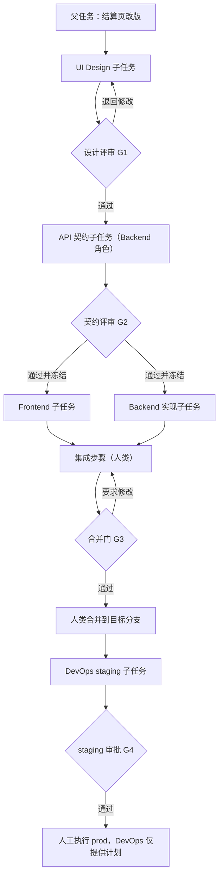

#### 5.3.2 步骤说明

| 步骤 | 操作者 | 动作 | 系统行为 | 输出/交付物 | 里程碑 |
|---|---|---|---|---|---|
| B1 | 人类 | 创建父任务，选择「角色流水线」模板 | 生成子任务 DAG、每个子任务的 Agent 建议与依赖；四个角色模板按需实例化，API 契约子任务绑定 Backend 模板，集成步骤绑定人类 | 父任务与子任务 | 计划（M2.1） |
| B2 | 系统 | 实例化 DAG | 只把无未完成依赖的子任务置为可运行；其余显示等待原因 | DAG 视图 | 计划（M2.1） |
| B3 | UI Design Agent | 执行设计子任务 | 在独立 worktree 中产出设计说明、token、组件状态、截图 | Design Spec 与截图 | 计划（M2.1） |
| B4 | 人类 | 设计评审 G1 | 查看设计证据；批准、要求修改或拒绝 | 设计审批记录 | 计划（M2.1） |
| B5 | Backend Agent（契约子任务） | 执行契约子任务 | 基于已批准设计产出 OpenAPI、错误码、示例与兼容性说明；只能写 `api/` 与 `docs/api/` | 契约文件与版本 | 计划（M2.1） |
| B6 | 人类 | 契约评审 G2 | 检查接口完整性、错误码、兼容性与安全约束；批准后冻结版本 | 契约审批与版本哈希 | 计划（M2.1） |
| B7 | Frontend Agent | 执行前端子任务 | 读取冻结契约与设计，写入前端目录；产出 diff、组件测试与截图 | 前端变更与证据 | 计划（M2.1） |
| B8 | Backend Agent（实现子任务） | 执行后端子任务 | 读取冻结契约，写入后端目录；产出 diff、单元/集成测试与迁移说明 | 后端变更与证据 | 计划（M2.1） |
| B9 | 系统 | 并行调度 | 两个 Run 在各自 worktree 中执行；检测路径冲突；完成后唤醒集成步骤 | 并行执行记录 | 计划（M2.1） |
| B10 | 人类集成者 | 执行集成步骤 | 创建 `ateam/integration/*` 集成分支，合并候选变更，解决有限冲突，运行端到端测试，产出集成证据；不得合并目标/受保护分支 | 集成分支与 E2E 报告 | 计划（M2.1） |
| B11 | 人类 | 合并门 G3 并执行目标分支合并 | 查看集成证据；M1 由 Review approved + 显式确认完成合并并写 MergeRecord；M2 起 Approval 批准并消费后执行；系统不自动合并 | 合并记录 | 计划（M2.1） |
| B12 | DevOps Agent | 执行 staging 子任务 | 生成 staging 部署计划并执行，产出验证证据；生成 prod 计划但不执行 | staging 结果与 prod 计划 | 计划（M2.1） |
| B13 | 人类 | staging 审批 G4 | 验证 staging 后批准上线计划 | staging 审批 | 计划（M2.1） |
| B14 | 人类 | 执行 prod | 按计划人工执行；系统记录执行人与结果 | prod 记录与审计 | 计划（M2.1） |

### 5.4 角色交付物契约

本节是流程级责任划分。交付物契约的字段定义、模板校验规则与契约版本规则见 `modules/collaboration-and-review.md` 与 `modules/agent-system.md`；出现冲突时以模块文档为准。角色模板只有四个：UI Design、Frontend、Backend、DevOps。API 契约是 Backend 角色的交付物；集成是人类步骤。

| 角色/步骤 | 必需输入 | 必需输出 | 验收证据 | 明确禁止 |
|---|---|---|---|---|
| UI Design | 父任务描述、品牌与组件约束、目标页面清单 | 设计说明、设计 token、组件状态矩阵、关键页面截图 | 设计评审清单逐项通过 | 修改业务代码、修改 API 契约 |
| Backend（含 API 契约） | 已批准设计、现有接口清单、兼容性要求、数据模型约束、后端路径边界 | OpenAPI 文档、错误码表、请求/响应示例、版本与变更说明；后端 diff、单元/集成测试、迁移说明 | 契约评审通过并冻结版本；测试通过；契约一致性检查通过 | 修改前端实现、跳过设计门、合并到受保护/目标分支 |
| Frontend | 冻结契约、已批准设计、前端路径边界 | 代码 diff、组件测试、页面截图、已知限制 | 构建与测试通过、截图覆盖主路径 | 修改契约文件、写入后端目录、合并到受保护/目标分支 |
| DevOps | 集成证据、环境清单、回滚要求 | staging 部署计划与结果、prod 计划、验证清单 | staging 验证通过、prod 计划人工可执行 | 执行 prod、修改业务代码、合并到受保护/目标分支 |
| 集成步骤（人类） | 前后端完成的 Run 与证据、目标分支、G3 通过记录 | 集成分支、冲突解决记录、E2E 报告；G3 通过后由人类另行执行目标分支合并 | E2E 全通过或明确豁免；M1 MergeRecord / M2 Approval 已消费 | 直接修改角色交付内容；在 G3 前合并目标分支；合并到受保护分支 |

### 5.5 路径与权限矩阵

本节是流程级示例。路径与命令矩阵的权威定义见 `modules/security-and-permissions.md` 与 `modules/agent-system.md`；具体值以模块文档与模板配置为准。所有角色与集成步骤默认禁止合并到受保护/目标分支；集成步骤只能写 `ateam/integration/*`，目标分支合并必须由人类在 G3 通过后另行执行。

| 角色/步骤 | allowedPaths 示例 | 只读路径 | 允许命令 | 禁止动作 |
|---|---|---|---|---|
| UI Design | `design/`、`docs/design/` | `src/`、`internal/`、`apps/web/` | 设计工具与截图命令 | 提交业务代码；合并任何分支 |
| Frontend | `apps/web/`、`packages/ui/` | `api/`、`docs/design/`、`internal/` | 包管理、构建、测试 | 修改后端与契约；合并任何分支 |
| Backend | `internal/`、`cmd/`、`packages/shared/`、`api/`、`docs/api/` | `apps/web/`、`design/` | Go 测试、构建、迁移生成、契约 lint | 修改前端实现；合并到受保护/目标分支 |
| DevOps | `deploy/`、`scripts/deploy/`、CI 配置 | 全仓库 | staging 部署与验证命令 | prod 执行、业务代码修改；合并到受保护/目标分支 |
| 集成步骤（人类） | 仅 `ateam/integration/*` 分支操作 | 全仓库 | `git merge`（仅集成分支）、E2E 测试 | 直接修改角色交付内容；在 G3 前合并目标分支；合并到受保护分支 |

路径边界必须在 M2.1 由运行时强制执行。仅靠 instructions 约束不算实现。两个并行 Run 若修改同一路径且该路径不在共享白名单内，调度器应在启动前或合并前阻止，并提示由人类集成步骤统一处理。

### 5.6 用户故事

| 编号 | Given/When/Then |
|---|---|
| US-B-01 | Given 我创建了一个带「角色流水线」模板的任务，When 模板实例化完成，Then 我能看到子任务 DAG（UI Design、API 契约（Backend 角色）、Frontend、Backend、集成（人类）、DevOps staging）及其依赖，只有 UI Design 可运行；模板本身只有四个角色模板。 |
| US-B-02 | Given UI Design 子任务完成，When 设计评审未通过，Then API 契约子任务保持等待，且退回原因写回设计任务。 |
| US-B-03 | Given API 契约已冻结，When 前端与后端并行执行，Then 两个 Run 使用同一契约版本，且都不能修改契约文件。 |
| US-B-04 | Given 前后端都完成且证据齐全，When 人类执行集成步骤，Then 集成者能看到双方的 diff 与测试结果，在 `ateam/integration/*` 分支上产出集成分支与 E2E 报告，且不能直接合并目标分支。 |
| US-B-05 | Given DevOps 子任务运行，When 它尝试执行 prod 部署，Then 系统拒绝该动作并提示必须由人类执行。 |
| US-B-06 | Given 我给 Backend Agent 挂载了一个技能，When 我启动 Run，Then Run 固定该技能版本，技能内容进入提示词前经过长度与来源校验，历史 Run 不受后续技能更新影响。 |
| US-B-07 | Given 我保存了一个任务模板，When 我用它实例化新任务，Then 系统生成预置 DAG、角色绑定与证据要求，且后续修改模板不反向影响已创建任务。 |

### 5.7 功能需求

| 编号 | 需求 | 验收标准 | 里程碑 | 状态 |
|---|---|---|---|---|
| FLOW-B-001 | 子任务必须支持 dependsOn；只有依赖全部完成的任务才可运行 | 依赖未满足时 Run 按钮禁用并显示等待项 | M2.1 | 计划（M2.1） |
| FLOW-B-002 | 每个角色模板必须定义交付物契约，包含必需输入、输出、证据与禁止动作；API 契约子任务复用 Backend 契约 | 缺少契约的角色模板不可发布；Backend 契约子任务有独立证据要求 | M2.1 | 计划（M2.1） |
| FLOW-B-003 | 流水线模板必须能一键实例化 DAG 与角色 Agent 绑定 | 创建后 30 秒内生成完整 DAG；只实例化四个角色模板 | M2.1 | 计划（M2.1） |
| FLOW-B-004 | API 契约必须有版本与哈希，下游 Run 必须固定使用某一版本 | Run 详情显示契约版本；契约变更不自动影响已排队 Run | M2.1 | 计划（M2.1） |
| FLOW-B-005 | 设计门与契约门未通过时，下游实现任务不得启动 | 强行启动返回 409，并列出未通过的门 | M2.1 | 计划（M2.1） |
| FLOW-B-006 | 前端与后端 Run 必须并行执行且互不覆盖 | 两个 Run 的 worktree 独立；同名文件修改进入冲突检测 | M2.1 | 计划（M2.1） |
| FLOW-B-007 | 并行 Run 的修改路径若重叠且不在白名单，必须在合并前阻止 | 冲突列表精确到文件与 Run | M2.1 | 计划（M2.1） |
| FLOW-B-008 | 集成步骤（人类）必须等待前后端 Run 完成且证据齐全，且只能写 `ateam/integration/*` | 缺少任一证据时集成步骤不可开始；尝试合并目标/受保护分支被拒绝并审计 | M2.1 | 计划（M2.1） |
| FLOW-B-009 | DevOps 的 staging 与 prod 必须分离 | staging 可执行；prod 只产出计划且等待人工执行 | M2.1 | 计划（M2.1） |
| FLOW-B-010 | 依赖任务失败时，下游必须进入 blocked 并显示上游失败原因 | 下游状态为 blocked；解除需人工或上游重试成功 | M2.1 | 计划（M2.1） |
| FLOW-B-011 | 四个角色模板必须内置默认 allowedPaths、requiredEvidence 与 forbiddenActions | 新建 Agent 时可查看并覆盖；模板列表只有 UI Design、Frontend、Backend、DevOps | M2.1 | 计划（M2.1） |
| FLOW-B-012 | 集成步骤失败必须保留冲突文件与失败用例作为证据 | 证据可在集成步骤记录与相关 Run 详情查看 | M2.1 | 计划（M2.1） |
| FLOW-B-013 | 提供 DAG 查询与依赖更新接口 | 可返回子任务、依赖、门状态与阻塞原因 | M2.1 | 计划（M2.1） |
| FLOW-B-014 | 提供契约版本与审批状态接口 | 下游 Run 创建时可校验契约版本 | M2.1 | 计划（M2.1） |
| FLOW-B-015 | Board 必须能按父任务折叠显示子任务 DAG | 支持展开、收起与阻塞原因提示 | M2.1 | 计划（M2.1） |
| FLOW-B-016 | 任务详情必须显示角色、依赖、门状态与必需证据 | 缺少证据时评审动作禁用 | M2.1 | 计划（M2.1） |
| FLOW-B-017 | 技能（Skill）必须可挂载到 Agent，Run 创建时固定技能版本 | Run 详情显示技能名称与版本；技能更新不影响历史 Run 与已排队 Run | M2.1 | 计划（M2.1） |
| FLOW-B-018 | 任务模板必须可保存并实例化为预置 DAG | 模板实例化生成子任务、依赖、角色绑定与证据要求；修改模板不影响已创建任务 | M2.1 | 计划（M2.1） |
| FLOW-B-019 | 技能与模板内容进入提示词前必须校验来源、版本与长度 | 超长或来源不在允许根内时拒绝；内容可审计 | M2.1 | 计划（M2.1） |
| FLOW-B-020 | 技能携带的脚本必须显式列入 allowedCommands 并经审批 | 未列入白名单的脚本不能执行；审批记录绑定技能版本 | M2.1 | 计划（M2.1） |

### 5.8 交付物

父任务最终交付物包括：已批准的设计说明与截图、冻结版本的 API 契约、前端与后端 diff、测试报告、集成分支与 E2E 证据、staging 验证记录、prod 部署计划与人工执行记录、完整审批链。每个子任务的交付物独立归档，不允许集成步骤覆盖上游证据。

### 5.9 异常与边界

| 异常 | 系统行为 | 人工处置 | 里程碑 |
|---|---|---|---|
| 设计被拒绝 | 设计任务回到可运行；下游保持等待 | 修改需求或更换 Agent 后重跑 | M2.1 |
| 契约存在破坏性变更 | 标记为 breaking；下游 Run 的证据失效 | 重新评审并升级契约版本 | M2.1 |
| 前后端修改同一文件 | 合并前阻止并列出冲突 | 由人类集成者或契约负责人裁决 | M2.1 |
| 后端测试失败 | 集成步骤不可开始 | 修复后端或缩小范围后重跑 | M2.1 |
| 集成冲突无法自动解决 | 集成步骤失败，保留冲突现场 | 人类解决或重新执行集成 | M2.1 |
| 集成步骤尝试合并目标/受保护分支 | 动作被拒绝并写审计 | 先取得 G3 审批，再由人类在目标分支执行合并 | M2.1 |
| staging 验证失败 | prod 计划不得提交审批 | 回滚 staging，修复后重新集成 | M2.1 |
| DevOps 尝试 prod | 动作被拒绝并写审计 | 人类按计划执行 | M2.1 |
| Agent 越界写路径 | Run failed，证据保留 | 调整权限或任务范围 | M2.1 |
| DAG 出现环 | 模板校验失败 | 修正依赖关系 | M2.1 |

### 5.10 验收点

| 验收点 | 验证方式 | 里程碑 |
|---|---|---|
| 模板实例化后只有首个任务可运行 | 检查每个子任务状态与依赖 | M2.1 |
| 只存在四个角色模板，API 契约与集成不单独设模板 | 检查模板列表与实例化结果 | M2.1 |
| 设计门未通过时 API 契约子任务（Backend）无法启动 | API 返回 409 与门状态 | M2.1 |
| 前后端并行 Run 互不覆盖 | 同时修改同名文件，检查两个 worktree | M2.1 |
| 契约版本冻结后不可被下游修改 | 下游 Run 写入契约文件时失败 | M2.1 |
| 集成步骤缺少任一上游证据时不可开始 | API 与 UI 均阻止 | M2.1 |
| 集成步骤无法合并目标分支 | 尝试合并返回 403/409，审计记录 | M2.1 |
| DevOps 的 prod 执行被拒绝 | 审计记录包含拒绝原因 | M2.1 |

### 5.11 技能与任务模板的用户流程（M2.1）

流程 B 的主线是「角色流水线模板实例化」，但 M2.1 还包含技能（Skill）与任务模板两类可复用资产。它们的共同要求是：可复用、可版本化、进入 Run 时固定版本、不得静默扩大权限。

#### 5.11.1 技能绑定流程

1. 用户在 Agents 详情或技能库中创建技能：名称、slug、版本、描述、来源路径与指令片段；来源路径必须在 Workspace 允许根内。
2. 用户把技能挂载到 Agent，并选择版本；M2.1 只支持本地文件与版本化配置，不做在线市场，不自动下载。
3. 创建 Run 时，系统把技能名称、版本与内容哈希写入 Run 快照；修改技能不改变已排队或历史 Run。
4. 技能内容进入提示词前，系统校验长度、来源与版本；超限或越界时拒绝启动并提示。
5. 技能若携带脚本入口，必须显式列入 Agent 的 `allowedCommands` 并经人类审批；不因被技能引用而自动获得执行权限。
6. 技能归档后不能新增引用，但已有引用继续可用；归档动作写审计。

#### 5.11.2 任务模板流程

1. 用户把当前任务或手工定义的 DAG 保存为任务模板：名称、版本、默认描述、角色绑定、依赖、证据要求与验收清单。
2. 用户从模板实例化新任务；系统在一个事务内生成父任务、子任务、依赖与 Agent 建议，失败则整体回滚。
3. 模板实例化后与模板解耦；修改模板不反向影响已创建任务。M0-M2.1 不做模板市场，模板只在本地 Workspace 内共享。
4. 模板版本变化写入审计；旧版本仍可用于复现历史任务。

#### 5.11.3 异常与证据

| 异常 | 系统行为 | 用户可见结果 | 里程碑 |
|---|---|---|---|
| 技能来源路径越界 | 拒绝保存或启动 | 提示允许根目录 | M2.1 |
| 技能内容超长 | 拒绝进入提示词，提示裁剪 | 显示长度上限与当前长度 | M2.1 |
| 技能脚本未列入白名单 | 拒绝执行并生成策略事件 | 提示申请命令审批 | M2.1 |
| 模板实例化失败 | 整体回滚，不留下半个 DAG | 显示失败原因与可修正项 | M2.1 |
| 模板版本冲突 | 拒绝覆盖，要求新版本 | 显示当前版本与差异 | M2.1 |

证据要求：Run 快照包含技能名称/版本/哈希；模板实例化记录包含模板 ID、版本与生成的对象清单；技能脚本审批记录绑定 Run 与命令哈希。字段级定义见 `modules/agent-system.md` 与 `modules/collaboration-and-review.md`。

## 6. 流程 C：同任务 Crew/队长模式（M2.2）

### 6.1 目的与定位

流程 C 解决的是「同一个任务需要多个 Agent 轮次协作」的问题，例如一个复杂重构需要先由架构 Agent 拆解，再由前端与后端成员交替修改，最后由测试 Agent 验证。它与流程 B 的区别是：流程 B 的协作靠预先定义的子任务 DAG；流程 C 的协作靠一个队长 Agent 在执行过程中动态拆解与派发。

产品决策是：先做「并行任务」，再考虑同任务 Crew。Crew 属于 M2.2，即 M2 的后置子阶段，不应阻塞 M2.1 主线。Crew 也不是「多个 Agent 在同一个会话里自由聊天」，而是结构化编排：队长产出计划，人类批准计划，队长按计划派发有界任务，成员返回结构化结果，队长负责集成与总结。

### 6.2 前置条件

| 条件 | 说明 |
|---|---|
| 并行任务流程稳定 | M2.1 的 DAG、契约、证据与门已可用 |
| Crew 模板可用 | 队长与成员角色、默认预算、最大轮次、停止条件已定义 |
| 工作区策略确定 | 共享运行工作区加锁，或每成员独立 worktree 后由队长集成 |
| 人类赞助者 | 必须有人批准计划、处理升级与最终合并 |
| 预算与轮次上限 | 每个 Crew 有明确的 token、时间与轮次上限 |

### 6.3 主流程

#### 6.3.1 时序图

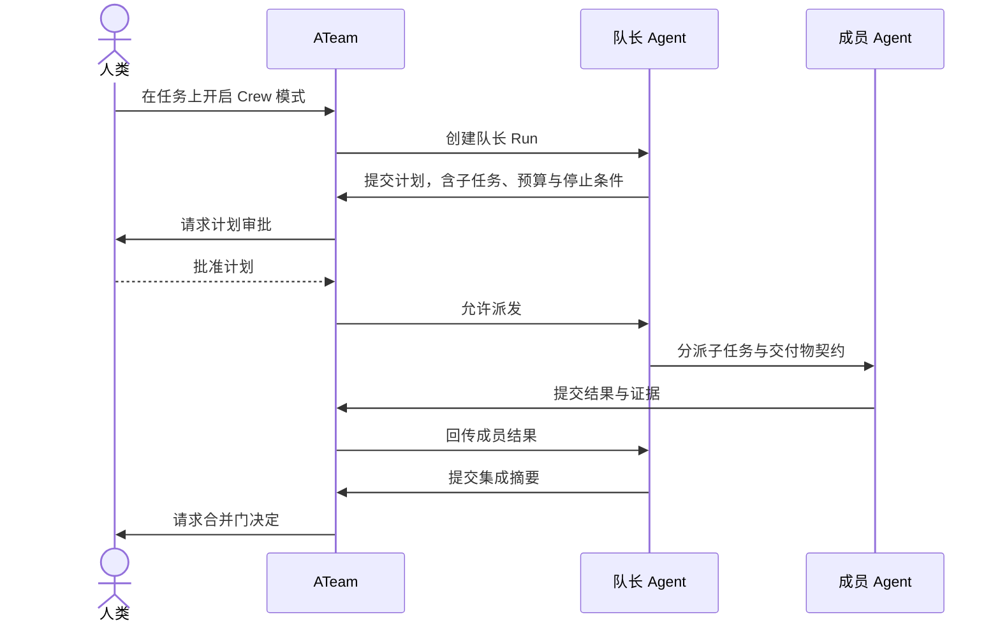

#### 6.3.2 步骤说明

| 步骤 | 操作者 | 动作 | 系统行为 | 输出/交付物 |
|---|---|---|---|---|
| C1 | 人类 | 在任务上开启 Crew 模式 | 校验任务无活动 Run、工作区干净、已设置预算与轮次上限 | Crew 会话 |
| C2 | 系统 | 创建队长 Run | 队长 Agent 获得任务、成员清单、预算与停止条件 | 队长 Run |
| C3 | 队长 Agent | 提交计划 | 计划包含子任务、指派、顺序、依赖、预算分配、风险与停止条件 | Plan 消息 |
| C4 | 人类 | 审批计划 | 批准、要求修改或拒绝；拒绝则不派发 | 计划审批记录 |
| C5 | 队长 Agent | 派发成员任务 | 每个成员 Run 只获得与其子任务相关的上下文切片与契约 | Assignment 消息与成员 Run |
| C6 | 成员 Agent | 执行并返回 | 结果必须包含摘要、证据、未决问题与下一步建议 | Result 消息 |
| C7 | 队长 Agent | 集成或要求修订 | 可在轮次上限内要求成员修订；可升级到人类 | 集成结果与摘要消息 |
| C8 | 队长 Agent | 提交 Crew 摘要 | 汇总变更、证据、风险与待决事项 | Crew Summary |
| C9 | 人类 | 评审与合并 | 走流程 D 的合并门；Crew 不自动合并 | 合并记录 |

### 6.4 交互与规则

1. Crew 消息只允许六种类型：plan、assignment、result、question、escalation、decision。每条消息必须包含 from、to、type、payload 与时间，并作为 RunEvent 持久化。
2. 队长不得直接修改成员的运行工作区；成员不得直接给其他成员派活。所有派发必须经过队长，所有上下文必须经过系统裁剪。
3. 共享运行工作区模式同一时刻只允许一个写入者；若需要并行写入，必须为每个成员创建独立 worktree，并由队长在集成阶段汇总成员运行工作区的变更；合并到受保护/目标分支仍由人类审批后执行。
4. 队长不能合并、不能部署、不能扩大预算、不能跳过审批门。发现需要扩大范围时，只能发出 escalation。
5. 停止条件至少包含：轮次上限、token/时间预算、连续失败次数、无新证据轮次、人类手动停止。任一条件触发即停止派发并生成 Crew 摘要。
6. 成员的上下文必须最小化：只包含任务目标、自己的子任务、相关契约与允许路径，不得注入其他成员的完整日志。
7. 人类可以随时暂停 Crew；暂停后不再派发新成员任务，已运行成员任务可继续完成或取消。
8. Crew 结束后保留完整消息时间线，供复盘与审计，不得只保留最终摘要。

### 6.5 交付物

Crew 计划与审批记录、成员 Run 列表与证据、队长集成摘要、未决问题与升级记录、预算消耗、最终合并门记录。Crew 摘要必须引用成员 Run ID，不能只写自然语言结论。

### 6.6 用户故事

| 编号 | Given/When/Then |
|---|---|
| US-C-01 | Given 我想在任务上开启 Crew，When 我提交开启请求，Then 系统要求我填写 token/时间预算、最大轮次与停止条件；缺少任一项时拒绝开启。 |
| US-C-02 | Given 队长已提交计划，When 计划尚未被人类批准，Then 系统不得派发任何成员 Run，成员列表保持为空并显示「等待计划审批」。 |
| US-C-03 | Given 一个成员 Agent 在执行中修改了允许路径之外的文件，When 系统检测到越界，Then 该成员 Run 进入 failed，保留违规证据，队长收到失败结果并决定重试、换成员或升级到人。 |
| US-C-04 | Given Crew 的预算或轮次已耗尽，When 队长尝试再次派发成员任务，Then 系统拒绝派发，停止 Crew 并生成包含成员 Run ID 与证据引用的摘要。 |
| US-C-05 | Given Crew 正在运行，When 人类点击暂停或终止，Then 暂停后不再派发新任务，终止后生成摘要且已运行的成员 Run 按取消规则处理。 |

### 6.7 异常与边界

| 异常 | 系统行为 | 人工处置 |
|---|---|---|
| 计划缺少停止条件或预算 | 拒绝计划，要求队长重写 | 修改 Crew 配置后重试 |
| 计划超出预算 | 计划不可批准，提示超出项 | 缩小范围或提高预算 |
| 成员连续失败 | 达到阈值后停止派发并升级 | 换 Agent、改范围或取消 |
| 队长循环派发相同任务 | 检测重复任务指纹，触发停止 | 人工介入重写计划 |
| 成员修改越界 | Run failed，保留违规证据 | 调整权限或更换成员 |
| 人类长时间未响应 | 暂停 Crew，保留现场 | 返回后继续或取消 |
| 共享运行工作区冲突 | 阻止写入，要求改独立 worktree | 调整工作区策略 |
| 计划未批准即尝试派发 | 拒绝派发并记录策略事件 | 先完成计划审批 |

### 6.8 功能需求

| 编号 | 需求 | 验收标准 | 里程碑 | 状态 |
|---|---|---|---|---|
| FLOW-C-001 | 同一任务同一时刻只能有一个活动 Crew 会话 | 重复开启返回 409 | M2.2 | 计划（M2.2） |
| FLOW-C-002 | Crew 计划必须包含子任务、指派、依赖、预算与停止条件 | 缺少字段的计划不可提交审批 | M2.2 | 计划（M2.2） |
| FLOW-C-003 | Crew 消息必须按六种类型持久化 | 时间线可按类型过滤，字段完整 | M2.2 | 计划（M2.2） |
| FLOW-C-004 | 队长不得合并、部署或扩预算 | 相关动作被拒绝并记录 escalation | M2.2 | 计划（M2.2） |
| FLOW-C-005 | 共享运行工作区必须加写锁，或强制每成员独立 worktree | 并发写入被阻止 | M2.2 | 计划（M2.2） |
| FLOW-C-006 | Crew 必须执行轮次、预算与连续失败停止条件 | 触发后不再派发并生成摘要 | M2.2 | 计划（M2.2） |
| FLOW-C-007 | 成员上下文必须裁剪，不包含其他成员完整日志 | 成员 Run 的 prompt 可审计且无越界上下文 | M2.2 | 计划（M2.2） |
| FLOW-C-008 | Crew 结束后必须保留完整消息时间线 | 归档后仍可查看每条消息 | M2.2 | 计划（M2.2） |
| FLOW-C-009 | 人类可暂停、恢复或终止 Crew | 暂停后不派发新任务；终止后生成摘要 | M2.2 | 计划（M2.2） |
| FLOW-C-010 | 任务详情提供 Crew 面板与消息时间线 | 可查看计划、成员状态、预算与升级 | M2.2 | 计划（M2.2） |
| FLOW-C-011 | Crew 计划未经人类批准不得派发成员 Run | 未批准时成员 Run 数为 0；强行派发返回 409 | M2.2 | 计划（M2.2） |
| FLOW-C-012 | 预算或轮次耗尽必须停止派发并生成摘要 | 摘要引用成员 Run ID 与证据；不再产生新 Run | M2.2 | 计划（M2.2） |

### 6.9 验收点

| 验收点 | 验证方式 | 里程碑 |
|---|---|---|
| 未批准计划前不会创建任何成员 Run | 检查 Run 列表与消息时间线 | M2.2 |
| 队长无法审批自己的计划 | 尝试批准返回权限错误 | M2.2 |
| 预算耗尽后停止派发并生成摘要 | 模拟低预算 Crew | M2.2 |
| 成员越界写路径导致 Run failed | 配置窄路径并尝试越界 | M2.2 |
| Crew 全程不产生合并动作 | 审计中无合并记录，只有审批请求 | M2.2 |
| 人类暂停后不再派发新任务 | 暂停并等待超过一个派发周期 | M2.2 |

## 7. 流程 D：评审与审批

### 7.1 目的与范围

流程 D 定义 ATeam 的五类人工门：设计评审、API 契约评审、合并审批、staging 审批、prod 执行确认。它适用于流程 A、B、C、F 的所有高风险动作。里程碑分界：M1 只有合并门，采用「Review approved + 显式确认 + expectedHeadCommit + MergeRecord」，不引入 Approval 实体；M2 起引入 Approval，覆盖合并、push、staging、删除等动作，并以 `actionFingerprint` 绑定证据与目标。核心原则是：授权绑定证据与目标，目标或证据变化时指纹/head 不匹配则不可执行；授权与执行分离；授权只能消费一次。审批状态与失效语义以 `02-domain-model.md` 4.6 为权威，本章不另设一套状态。

#### 7.1.1 前置条件

| 条件 | 说明 |
|---|---|
| 已有可复核证据 | 证据已绑定 Run、版本与哈希，可在应用内打开 |
| 已配置门与审批人 | 门类型、必需证据、审批角色已定义；M1 合并门至少需要 Review 评审者与合并确认人 |
| 目标分支或环境已定义 | 合并目标、staging/prod 环境可访问且受保护 |
| 无冲突的活动操作 | 同一目标没有进行中的合并或部署 |
| 审批人具备权限 | 审批人角色覆盖该门的授权范围；M1 由本地用户执行 Review 与合并确认 |
| 合并门的目标已固定 | M1 请求携带 `expectedHeadCommit`、`targetBranch`、`strategy` 与显式 `confirm=true`；M2 起还要求有效 Approval |

### 7.2 审批门矩阵

| 门 | 触发时机 | 必需证据 | 审批人/确认人 | 通过后动作 | 里程碑 |
|---|---|---|---|---|---|
| G1 设计评审 | UI Design Run 完成 | 设计说明、token、截图、验收清单 | 任务发起人或指定设计评审者 | 允许 API 契约子任务（Backend）启动 | M2.1 |
| G2 契约评审 | Backend 的契约子任务完成 | OpenAPI、错误码、示例、兼容性说明 | 后端负责人或架构评审者 | 冻结契约版本，允许前后端实现子任务启动 | M2.1 |
| G3 合并门（M1 Review+MergeRecord；M2 起叠加 Approval） | 集成步骤完成或流程 A 的 Run 完成 | diff、测试报告、集成证据、风险说明 | 代码所有者或评审者 | 允许合并到目标分支；由人类执行合并 | M1/M2.1 |
| G4 staging 审批 | DevOps staging Run 完成 | staging 部署结果、验证清单、回滚说明 | 发布负责人 | 允许提交 prod 计划 | M2.1 |
| G5 prod 执行确认 | prod 计划审批通过 | prod 计划、回滚方案、监控项 | 发布负责人 | 人类手动执行，系统记录结果 | M2.1/M4 |

G3 在 M1 由「Review approved + 显式确认 + MergeRecord」承担；M2.1 起叠加 Approval。G1、G2、G4、G5 的 Approval 从 M2.1 起引入。下文的 Approval 状态机与指纹语义适用于 M2 及以后；M1 的合并门使用 `expectedHeadCommit` 与证据快照哈希校验，不伪造 Approval 记录（`02-domain-model.md` 3.15、DM-MRG-001～004）。

#### 7.2.1 门与执行的主流程

下图是 M2 起的 Approval 流程。M1 合并门没有 Approval，流程是：Review approved → 合并对话框（展示目标分支、expectedHeadCommit、证据快照）→ 人类显式确认 → 服务端校验 → 写 MergeRecord。

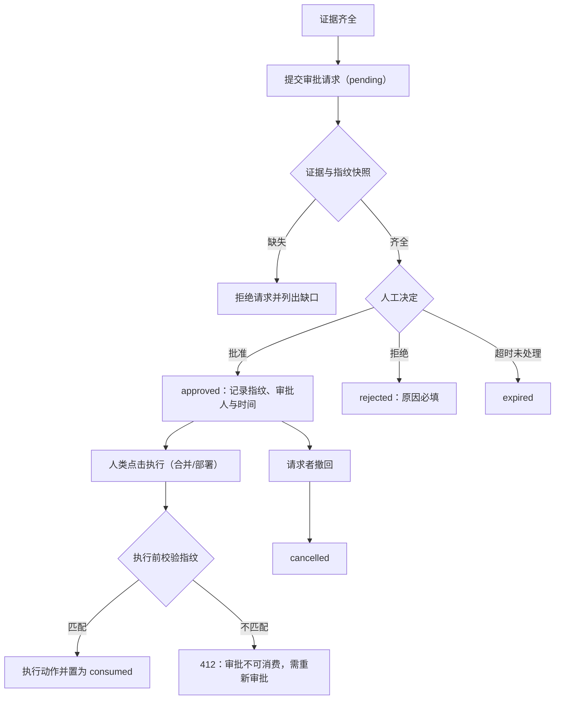

门与执行的关系：门只负责「是否允许」，执行是独立的第二次人类动作；批准后不自动合并或部署。M2 起，证据或目标变化不会把审批改成 `expired`，而是让指纹校验失败（412），审批保持 `approved` 但不可消费。M1 的合并门同理：Review approved 后，目标 head 或证据快照变化会使合并返回 412，必须重新评审，而不是静默 rebase 或覆盖。

### 7.3 审批状态机与失效语义（M2 起）

M1 不引入 Approval 实体。M1 的合并门状态由 Review（pending/in_review/approved/changes_requested/superseded/cancelled）与 MergeRecord（pending/merged/conflicted/failed/invalidated）表达；`02-domain-model.md` DM-MRG-001～004 是权威。以下 Approval 状态机从 M2 起适用。

审批状态以 `prd/02-domain-model.md` 4.6 为权威，只使用以下六个状态：`pending`、`approved`、`rejected`、`expired`、`cancelled`、`consumed`。本章旧版的 `requested` 对应 `pending`；旧版的「要求修改」不再作为审批状态，而是 `rejected` 或重新发起审批；旧版的 `revoked` 对应 `cancelled`。注意：Review 实体的 `changes_requested` 是评审状态（`02-domain-model.md` 4.5），不是 Approval 状态，二者不得混用。

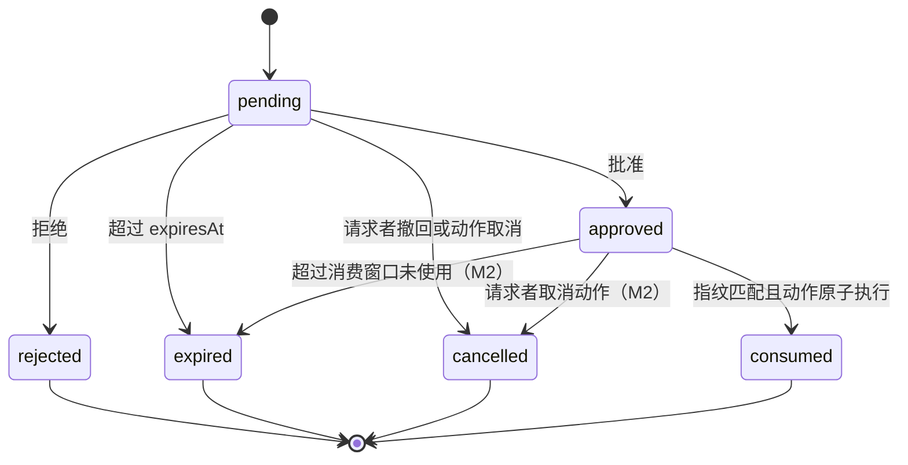

状态规则：

- `pending`：等待人类审批，下游动作不可执行。界面可以显示「待审批/门已打开」，但 API 状态值是 `pending`。
- `approved`：已批准但尚未执行；记录 `decidedBy`、`decidedAt` 与 `actionFingerprint`。下游动作可执行，但不会自动执行。
- `rejected`：已拒绝；必须填写原因；任务需要重新规划或取消。终态。
- `expired`：仅表示超过 `expiresAt`，或批准后超过消费窗口（M2）；不表示证据变化。终态。
- `cancelled`：请求者撤回或动作不再需要；必须填写原因。终态。
- `consumed`：审批已用于一次具体动作，只能消费一次；记录 `consumedAt` 与 `consumedBy`。终态。

指纹与失效：

- `actionFingerprint` 覆盖动作类型、目标 ID、commit SHA、diff 哈希、环境、命令与参数。证据或目标变化导致指纹不匹配时，执行接口返回 412，审批保持 `approved` 但不可消费，必须创建新的审批请求（`02-domain-model.md` DM-APPR-003）。
- 合并审批默认有效期 24 小时；staging 默认 4 小时；prod 计划 30 分钟且不允许「不自动过期」例外；具体阈值以 `modules/security-and-permissions.md` 为准（`02-domain-model.md` 4.6）。批准后的消费窗口由同一策略配置。
- 审批记录只追加，不覆盖；拒绝、过期、撤回、已消费都保留，用于复盘与审计。
- `requested` 是 `pending` 的 API 别名，`revoked` 是 `cancelled` 的别名；数据库只存规范值，API 输入接受别名并归一化（`02-domain-model.md` 4.6）。

### 7.4 各门的操作流程

#### 7.4.1 设计评审 G1

1. UI Design Run 完成并提交设计证据。
2. 系统创建 G1 请求，通知设计评审者。
3. 评审者逐项检查验收清单：页面覆盖、状态完整、可访问性、token 一致性、与现有组件兼容性。
4. 通过则冻结设计版本；要求修改则记录 rejected 并把修改要求写回设计任务；拒绝则终止该设计方向。
5. 设计版本变化会使 G2 及之后已批准内容的 `actionFingerprint` 不匹配；下游执行返回 412，需要重新审批，而不是把审批状态改成 expired。

#### 7.4.2 API 契约评审 G2

1. Backend Agent 的契约子任务完成并提交契约文件与兼容性说明。
2. 评审者检查路径、方法、状态码、错误码、分页、鉴权、幂等性与示例。
3. 通过后冻结版本与哈希；破坏性变更必须显式标注并升级主版本。
4. 前端与后端实现子任务必须引用冻结版本；任何修改契约的尝试都会失败。
5. 契约升级会使引用旧版本的实现证据标记为 stale，并使其审批指纹不匹配。

#### 7.4.3 合并门 G3（M1 Review+MergeRecord；M2 起叠加 Approval）

1. Run 完成且证据齐全；缺少 diff 或测试报告时不允许请求合并（409）；head 或证据快照不匹配时返回 412。
2. 评审者查看 diff、测试结果、风险与回滚说明；M1 先完成 Review approve，M2 起还需创建/批准 Approval。
3. M1：Review approved 后，人类在合并对话框确认目标分支、`expectedHeadCommit`、策略与证据摘要；服务端校验通过后执行合并并写 MergeRecord。批准与执行仍是两个动作，系统不自动合并。
4. M1：合并前若目标分支出现新提交、源分支 head 变化或证据快照变化，合并返回 412，原 Review 的合并资格失效，必须重新评审（`02-domain-model.md` DM-MRG-003）。M2：执行接口重新校验 `actionFingerprint`；不匹配返回 412，Approval 保持 `approved` 但不可消费；审批超过 `expiresAt` 才进入 `expired`。
5. 合并冲突不得由 Agent 自动强推；必须由人类或人类集成步骤处理。

#### 7.4.4 staging 审批 G4

1. DevOps Run 在 staging 执行部署并产出验证证据。
2. 发布负责人检查健康检查、关键路径、日志与回滚步骤。
3. 通过后允许提交 prod 计划；失败则回滚 staging 并重开集成步骤。
4. staging 审批不授权 prod 执行。

#### 7.4.5 prod 执行确认 G5

1. DevOps Agent 产出 prod 计划：步骤、命令、影响面、回滚、监控与负责人。
2. 发布负责人审批计划。
3. 人类按计划执行；系统记录执行人、时间、结果与偏差。
4. Agent 不得持有 prod 执行权限；任何自动 prod 执行请求都被拒绝并审计。

#### 7.4.6 授权通过后的执行与消费

1. 批准不等于执行。合并、staging、删除等动作仍由具备权限的人类在 ATeam 内点击执行；prod 由人类在 ATeam 之外执行并回填结果。
2. M1 合并：Review approved 后，人类提交合并请求（`reviewId`、`expectedHeadCommit`、`targetBranch`、`strategy`、`confirm=true`）；服务端校验证据快照与目标分支后执行，并写入 MergeRecord。`result=merged` 的记录不可修改；`expectedHeadCommit` 或证据快照变化返回 412，必须重新评审。
3. M2 起：执行前系统重新计算 `actionFingerprint`，并与 Approval 记录比对；不匹配返回 412，不执行动作，不改变审批状态。动作原子成功后才把审批置为 `consumed` 并记录 `consumedAt`/`consumedBy`。
4. 动作失败时 Approval 保持 `approved`，可以重试，但超过消费窗口或有效期自动 `expired`；一次审批只能消费一次，重复执行返回 409。
5. 审批被 `rejected`、`expired` 或 `cancelled` 后，下游动作一律拒绝；任务回到可修改状态或由人类重新规划。
6. 合并执行、审批决定与删除动作都写入审计；团队模式还记录执行人、时间、目标与结果。

### 7.5 用户故事

| 编号 | Given/When/Then |
|---|---|
| US-D-01 | Given 设计证据不完整，When 我尝试批准 G1，Then 批准按钮禁用并列出缺失项。 |
| US-D-02 | Given 契约评审通过并冻结，When 前端 Run 尝试修改契约文件，Then 写入被拒绝且 Run 失败。 |
| US-D-03 | Given M2 的合并审批已批准，When 目标分支出现新提交或 diff 变化，Then 执行合并返回 412，审批保持 approved 但不可消费，界面要求重新发起审批。 |
| US-D-04 | Given 我是 Run 的发起人且团队开启四眼原则，When 我尝试批准自己的合并，Then 系统拒绝并提示需要另一名评审者。 |
| US-D-05 | Given DevOps 产出 prod 计划，When 任何 Agent 尝试执行 prod，Then 系统拒绝并记录审计事件。 |
| US-D-06 | Given M2 的合并审批已批准且指纹匹配，When 我点击执行合并，Then 动作成功后审批变为 consumed 并记录 consumedAt/consumedBy；再次点击执行返回 409。 |
| US-D-07 | Given 我在 M1 本地单用户模式确认合并，When 我提交合并请求，Then 界面明确提示目标分支、expectedHeadCommit 与证据摘要并要求二次确认，系统写入 MergeRecord 并记录本地用户标识与时间。 |
| US-D-08 | Given M1 的合并请求携带 expectedHeadCommit，When 目标分支或源分支 head 已变化，Then 合并返回 412，不写 merged 记录，原 Review 的合并资格失效并要求重新评审。 |

### 7.6 功能需求

| 编号 | 需求 | 验收标准 | 里程碑 | 状态 |
|---|---|---|---|---|
| FLOW-D-001 | 每个门必须有明确的触发条件、必需证据与审批人/确认人 | 缺少任一配置时门不可用 | M1/M2.1 | 计划（M1 合并门 / M2.1 其它门） |
| FLOW-D-002 | 非批准决定必须填写原因 | Review 的 changes_requested 或 Approval 的 rejected 原因为空时提交失败 | M1/M2 | 计划（M1/M2） |
| FLOW-D-003 | M1 MergeRecord 必须记录操作者、时间、Review、expectedHeadCommit、目标/源分支、策略、证据快照与结果；M2 Approval 必须记录 actionFingerprint、决定、expiresAt、consumedAt/consumedBy | 字段完整且可导出；每条合并尝试有记录 | M1/M2 | 计划（M1/M2） |
| FLOW-D-004 | M1 head 或证据快照变化必须使合并不可执行；M2 证据或目标变化必须使 Approval 不可消费 | M1 返回 412 且不写 merged；M2 返回 412，审批保持 approved 但不可消费 | M1/M2 | 计划（M1/M2） |
| FLOW-D-005 | 授权/确认与执行必须分离 | Review approved 或 Approval approved 后都不自动合并或部署 | M1/M2 | 计划（M1/M2） |
| FLOW-D-006 | 团队模式受保护分支合并必须四眼原则 | 发起人不能单独批准自己的合并 | M3 | 计划（M3） |
| FLOW-D-007 | prod 执行必须由人类完成并记录 | Agent 执行请求被拒绝；人类执行有审计 | M2 | 计划（M2） |
| FLOW-D-008 | 授权/确认必须有权限校验；M1 只要求本地用户标识与合并二次确认，M3 要求 RBAC | M1 记录本地用户与确认；M3 无权限用户只能查看状态，不能操作 | M1/M3 | 计划（M1/M3） |
| FLOW-D-009 | 审批链必须可按任务与 Run 导出 | 导出包含所有门、决定与证据引用 | M3 | 计划（M3） |
| FLOW-D-010 | 任务详情必须显示当前门、等待人、缺失证据与下一步 | 门状态与实际可执行动作一致 | M1/M2.1 | 计划（M1/M2.1） |
| FLOW-D-011 | 证据查看器必须支持 diff、日志、截图与契约文件 | 四类证据均可在应用内打开（M1 的 screenshot 为可选 Artifact） | M1/M2.1 | 计划（M1/M2.1） |
| FLOW-D-012 | 合并/审批动作必须二次确认并展示影响 | 确认框列出目标分支或环境、head/指纹与风险 | M1/M2.1 | 计划（M1/M2.1） |
| FLOW-D-013 | 提供 Review、MergeRecord 与 Approval 的请求、决定、撤回与查询接口 | M1 提供 Review/MergeRecord 接口；M2 提供 Approval 接口；非法迁移返回 409 | M1/M2 | 计划（M1/M2） |
| FLOW-D-014 | 提供证据清单与哈希校验接口 | 可验证证据未被篡改 | M1 | 计划（M1） |
| FLOW-D-015 | 提供门状态查询接口 | 返回当前门、证据是否齐全与阻塞原因 | M1/M2.1 | 计划（M1/M2.1） |
| FLOW-D-016 | M1 合并前必须校验 expectedHeadCommit 与证据快照；M2 Approval 执行前必须校验 actionFingerprint | 不匹配返回 412，不执行动作，不改变授权状态 | M1/M2 | 计划（M1/M2） |
| FLOW-D-017 | M1 每个 Run 最多一条 merged MergeRecord；M2 Approval 动作成功后置 consumed 且只能消费一次 | 重复合并/执行返回 409；consumedAt 被记录 | M1/M2 | 计划（M1/M2） |
| FLOW-D-018 | M2 执行失败时审批保持 approved，可重试，超时后 expired | 失败不置 consumed；超过消费窗口自动 expired | M2 | 计划（M2） |
| FLOW-D-019 | M1 本地模式必须记录本地用户标识与合并二次确认 | MergeRecord 包含本地用户、确认动作与时间 | M1 | 计划（M1） |
| FLOW-D-020 | 授权/审批执行结果必须写审计 | 审计包含 reviewId/approvalId、执行人、目标、结果与时间 | M1/M3 | 计划（M1/M3） |

### 7.7 交付物

M1 的合并门产出 MergeRecord：操作者、时间、Review、expectedHeadCommit、目标/源分支、策略、commit、结果、冲突文件与证据快照哈希；`merged` 记录不可修改。M2 起每个门产出 Approval 记录：门类型、对象 ID、证据引用与哈希、`actionFingerprint`、审批人、时间、决定、原因、有效期、`consumedAt` 与 `consumedBy`；MergeRecord 通过可空 `approvalId` 关联 Approval，M1 历史记录不回填。两类记录都只追加，不覆盖；被拒绝、过期、撤回或已消费的记录同样保留，用于复盘与审计。

### 7.8 异常与边界

| 异常 | 系统行为 | 用户可见结果 | 里程碑 |
|---|---|---|---|
| 证据缺失 | M1 合并请求被拒绝；M2 门保持 pending，批准动作禁用 | 显示缺失证据清单 | M1/M2 |
| 证据哈希不一致 | 拒绝合并/审批或标记证据被篡改 | 提示重新生成证据 | M1/M2 |
| 权限不足 | 拒绝操作并记录 | 提示需要何种角色 | M1/M3 |
| 并发审批 | 第一个有效决定生效，后续返回冲突 | 显示当前决定与审批人 | M2 |
| M1 目标/源分支 head 变化 | 合并返回 412，不写 merged，原 Review 合并资格失效 | 合并按钮重新要求评审与确认 | M1 |
| M2 审批后新增提交或 diff 变化 | 指纹不匹配，执行返回 412；审批保持 approved 但不可消费 | 合并/部署按钮重新要求审批 | M2 |
| 审批超过有效期 | 状态变为 expired | 显示过期时间与重新发起入口 | M2 |
| M1 重复合并 | 返回 409；每个 Run 最多一条 merged 记录 | 提示已完成合并 | M1 |
| M2 重复执行已消费审批 | 返回 409 | 提示审批已消费，需要新审批 | M2 |
| 目标分支被保护或不存在 | 合并失败并保留记录 | 显示分支错误与处理建议 | M1/M2 |
| 审批人离职或角色变更 | 审批仍有效但执行需当前权限 | 管理员可撤回并重新指派 | M2/M3 |

### 7.9 验收点

| 验收点 | 验证方式 | 里程碑 |
|---|---|---|
| 缺证据时无法请求合并/批准 | 移除测试报告后尝试合并或批准 | M1/M2 |
| Review approved 后不自动合并 | 观察合并仍需显式确认 | M1 |
| Approval approved 后不自动执行 | 观察合并/部署仍需点击 | M2 |
| M1 head 变化使合并不可执行 | 批准后追加提交，合并返回 412，原 Review 资格失效 | M1 |
| M2 指纹变化使审批不可消费 | 批准后追加提交，执行合并返回 412；审批仍为 approved | M2 |
| M1 每个 Run 最多一次 merged | 成功合并后再次执行，返回 409 | M1 |
| M2 审批只能消费一次 | 成功合并后再次执行，返回 409 | M2 |
| M1 本地合并需二次确认并留痕 | 本地单用户确认合并，检查确认框与 MergeRecord | M1 |
| 非授权用户不能审批 | 使用无权限团队账号操作 | M3 |
| 四眼原则生效 | 发起人尝试自批合并 | M3 |

## 8. 流程 E：失败、取消、重试、阻塞、升级到人

### 8.1 目的与范围

流程 E 定义 Run 没有顺利结束时会发生什么。目标是让每一种异常都有确定的终态、明确的证据和下一步动作，避免出现「一直在运行」「静默失败」「无人知道该找谁」的状态。

#### 8.1.1 前置条件

| 条件 | 说明 |
|---|---|
| Run 处于可处理状态 | 非终态可取消；终态可重试、归档或升级 |
| 事件与工作区可访问 | 能读取最后事件、错误输出与工作区状态 |
| 错误分类可用 | 已定义错误码、可重试判断与建议动作 |
| 重试策略已配置 | 重试上限、是否换 Agent、旧工作区处理规则 |
| 升级通道可用 | M2 起收件箱可用；责任人可被指派 |

### 8.2 失败分类

| 代码 | 类型 | 检测方式 | M0 行为 | 目标行为 | 里程碑 |
|---|---|---|---|---|---|
| F1 | runtime_not_found | CLI 不在 PATH | Run failed，错误写入 | 提供安装/配置引导 | M0/M1 |
| F2 | runtime_exit_nonzero | 进程非零退出 | Run failed，保留 stderr | 分类为可重试或需人工 | M1 |
| F3 | timeout | 超过 timeoutMinutes | Run failed | 标记超时，保留最后事件 | M0/M1 |
| F4 | permission_denied | 路径或命令越界 | 未强制 | Run failed，保留违规证据 | M2.1 |
| F5 | checks_failed | 测试/构建失败 | 未结构化 | Run 进入 failed，errorCode=checks_failed，附失败用例 | M1 |
| F6 | merge_conflict | 合并或集成冲突 | 无合并能力 | 保留冲突现场，升级到人 | M1/M2.1 |
| F7 | blocked_by_agent | Agent 主动声明阻塞 | 可作为 summary 文本 | 结构化 blocked 事件，任务置 blocked | M1/M2 |
| F8 | stalled | 长时间无新事件或重复动作 | 无检测 | 心跳与无进展检测，提示或终止 | M2 |
| F9 | evidence_missing | 缺少必需证据 | 无检查 | 不可请求审批，提示补证据 | M1 |
| F10 | workspace_prepare_failed | worktree/目录创建失败 | Run failed | 明确失败原因与清理建议 | M0/M1 |
| F11 | interrupted | 服务重启、Runner 失联或租约过期 | 重启后不恢复 | Run failed，errorCode=interrupted，failureDetail 记录 app_restart/runner_lost/lease_expired | M1/M3 |

### 8.3 失败与重试流程

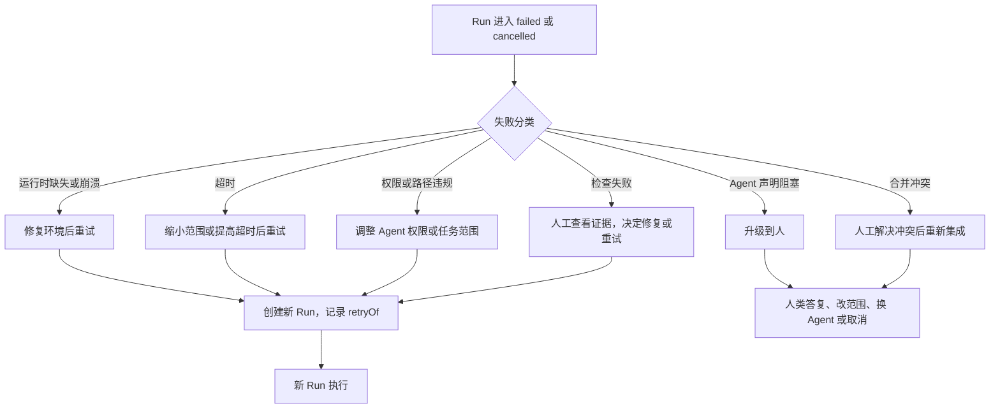

处理步骤如下：

1. 系统在 Run 进入终态时写入错误码、最后事件与证据引用。
2. 用户从 Run 详情选择重试、取消、标记阻塞或升级到人。
3. 若重试，系统校验重试上限与旧工作区状态，创建新 Run 并记录 retryOf。
4. 若升级，系统创建待处理项并通知责任人，任务进入 blocked。
5. 责任人处理后，任务按原因回到 todo、in_progress 或 blocked；重试会创建新 Run，所有动作写入事件与审计。

### 8.4 重试规则

1. 重试永远创建新 Run，原 Run 保持终态与历史证据，不允许重置状态。
2. 新 Run 必须记录 retryOf、重试原因与重试策略：同 Agent、换 Agent、修改任务后重试。
3. 换 Agent 重试时，必须展示两个 Agent 的差异（runtime、model、instructions 摘要、权限），避免盲目切换。
4. 同一个 Task 的连续重试次数应有上限；达到上限后必须升级到人，不得无限自动重试。
5. 重试前若旧 Run 的运行工作区仍有未提交变更，必须先归档或明确丢弃，禁止静默覆盖。
6. M1 的「重试」是人工动作；M4 的自动重试只允许针对明确可重试的错误类型，并且仍需人工合并。

### 8.5 取消规则

| Run 状态 | 取消行为 | 工作区处理 | 事件 |
|---|---|---|---|
| queued | 从队列移除或标记跳过；不得再执行 | 无需清理 | run.cancelled |
| preparing | 中止准备，清理半成品目录 | 删除或归档半成品 | run.cancelled |
| running | 向 Runtime 发送取消信号，给予宽限期后终止进程 | 保留变更供检查，标记不完整 | run.cancelled |
| completed/failed/cancelled | 幂等返回，不改变状态 | 不处理 | 无新事件 |

当前 M0 的取消对 queued 与 preparing 存在竞态：API 会把记录标记为 cancelled，但调度器仍可能取到该 Run 并继续执行；preparing 阶段取消也可能因为取消函数尚未注册而无效。M1 必须在 worker 取件时检查终态，并在准备阶段注册可取消上下文。

#### 8.5.1 取消后的任务状态与重开

取消 Run 不会自动改变 Task 状态（`02-domain-model.md` 4.4）：Task 保持原状态（M1 通常为 in_progress），由人类选择重新排队（T-06）、置为 blocked（T-07）或取消任务（T-10）。M1 不自动把 Task 退回 todo，避免系统替人类决定「放弃还是重试」。

失败与取消的联动（M1）：可重试失败（如 `runtime_error/runtime_unavailable`）或用户主动取消时，Task 保持 in_progress（T-14），允许直接重试；不可重试失败（`permission_denied`、`invalid_task_state` 或不可恢复的 `workspace_error`）时，Task 进入 blocked 并写入 `blockedReason`（T-13）；超时默认按可重试处理，回到 in_progress 并提示重试。任何情况下都不得把 Run 的终态直接映射为 Task 的 cancelled。

M2 起支持两条有审计的恢复路径：

- done → todo（T-11，重开）：必须提供重开原因；M2 起还要求权限；系统记录审计事件，并允许创建新的 Run。已完成的 Review 与合并记录保留，不被删除。
- cancelled → backlog（T-12，恢复）：必须提供恢复原因；系统记录审计事件；恢复后的任务需要重新进入 todo 才能运行。

因此，1.4 的 Task 状态图把 done 与 cancelled 画成正常终态，但允许 M2 的审计重开/恢复；它们不是永久不可恢复的墓碑状态。

### 8.6 阻塞与升级到人

1. Agent 可以通过结构化事件声明阻塞，必须包含阻塞类型、已尝试动作、需要的决策与建议选项。
2. 系统把任务置为 blocked，记录阻塞原因与责任人；若任务已有下游依赖，下游保持等待。
3. 升级路径按严重度分三级：
   - L1：信息不足，发起人补充上下文后重跑。
   - L2：权限或环境问题，管理员处理。
   - L3：方向性冲突或高风险决策，需要任务所有者或团队负责人裁决。
4. M2 起，升级进入收件箱，支持指派、回复、关闭；M4 增加 Webhook/通知渠道。
5. 人类处理选项固定为：补充信息、调整范围、更换 Agent、拆分子任务、取消任务；M2 起还包括重开已完成任务（T-11）与恢复已取消任务（T-12）。每次处理都必须留下记录。

### 8.7 用户故事

| 编号 | Given/When/Then |
|---|---|
| US-E-01 | Given 一个 Run 因超时失败，When 我打开 Run 详情，Then 我能看到超时原因、最后一条事件和重试入口。 |
| US-E-02 | Given 一个 Run 处于 queued，When 我取消它，Then 它不会再被执行，且状态保持 cancelled。 |
| US-E-03 | Given Agent 声明需要产品决策，When 它发出阻塞事件，Then 任务进入 blocked，收件箱出现待处理项。 |
| US-E-04 | Given 我选择换 Agent 重试，When 新 Run 创建，Then 原 Run 保持不变且新 Run 记录 retryOf 与原因。 |
| US-E-05 | Given 同一任务连续失败达到上限，When 再次尝试重试，Then 系统要求先由人处理，不再自动创建 Run。 |
| US-E-06 | Given 一个任务已 done 或 cancelled，When 我以有权限的身份提交重开/恢复并填写原因，Then 任务回到 todo 或 backlog，系统写入审计事件，历史 Run 与证据保持不变。 |

### 8.8 功能需求

| 编号 | 需求 | 验收标准 | 里程碑 | 状态 |
|---|---|---|---|---|
| FLOW-E-001 | 重试必须创建新 Run 并记录 retryOf、attempt 与原因 | 重试链可查；原 Run 不可变 | M1 | 计划（M1） |
| FLOW-E-002 | 取消 queued Run 后调度器不得执行 | 取消后等待超过调度周期无新事件 | M1 | 计划（M1） |
| FLOW-E-003 | preparing 阶段必须支持可靠取消 | 取消后不进入 running | M1 | 计划（M1） |
| FLOW-E-004 | running 取消必须有宽限期与强制终止 | 宽限内正常退出；超时后终止并标记 | M1 | 计划（M1） |
| FLOW-E-005 | 失败必须分类并写入结构化错误码 | Run 详情显示错误码与建议动作 | M1 | 计划（M1） |
| FLOW-E-006 | 同一任务重试次数必须有上限 | 超过上限返回 409 并要求人工处理 | M1 | 计划（M1） |
| FLOW-E-007 | Agent 阻塞必须产生结构化事件 | 事件包含类型、已尝试动作、待决策项 | M1/M2 | 计划（M1/M2） |
| FLOW-E-008 | 必须检测长时间无进展的 Run | 超过阈值产生 stalled 事件并可终止 | M2 | 计划（M2） |
| FLOW-E-009 | 任务 blocked 必须记录原因与责任人 | 详情可见阻塞历史与当前责任人 | M1 | 计划（M1） |
| FLOW-E-010 | 上游失败必须使下游保持 blocked | 下游不可运行且显示上游 Run | M2.1 | 计划（M2.1） |
| FLOW-E-011 | 升级到人必须有明确级别与处理记录 | 收件箱可筛选 L1/L2/L3 | M2 | 计划（M2） |
| FLOW-E-012 | Run 详情必须展示错误码、最后事件与建议动作 | 失败 Run 不再只有一段错误文本 | M1 | 计划（M1） |
| FLOW-E-013 | 取消动作必须二次确认并显示影响 | 确认框说明将终止执行与工作区保留策略 | M1 | 计划（M1；M0 直接调用取消，无确认） |
| FLOW-E-014 | 阻塞与升级必须在任务页显著可见 | 任务卡片与详情都有阻塞标识 | M1/M2 | 计划（M1/M2） |
| FLOW-E-015 | done 重开（T-11）与 cancelled 恢复（T-12）必须要求原因、权限与审计 | 缺少原因返回 400；越权返回 403；审计可查 | M2 | 计划（M2） |
| FLOW-E-016 | 超时必须映射为 errorCode=timeout 并保留最后事件 | 低超时任务产生 timeout 错误码；错误文本包含超时原因 | M1 | 计划（M1；M0 常表现为 signal: killed） |
| FLOW-E-017 | 取消 Run 不得自动改变 Task 状态 | 取消后 Task 保持原状态（M1 通常为 in_progress），需人工选择下一步 | M1 | 计划（M1） |
| FLOW-E-018 | 不可重试失败必须使 Task 进入 blocked 并记录原因 | errorCode 属于 permission_denied、invalid_task_state 或不可恢复 workspace_error 时 Task 为 blocked；可重试失败保持 in_progress | M1 | 计划（M1） |

### 8.9 交付物

失败 Run 的错误分类与证据、重试链、取消记录、阻塞记录、升级记录与处理结果。所有记录必须可追溯到具体 Run 与操作者，不得只保留最终状态。

### 8.10 异常与边界

| 异常 | 系统行为 |
|---|---|
| 取消与完成同时发生 | 以先到达的终态为准，另一动作幂等返回 |
| 重复点击重试 | 幂等键或前端去重，避免创建多个相同 Run |
| 旧运行工作区有未提交变更 | 阻止直接重试，要求归档或确认丢弃 |
| 阻塞事件格式非法 | 记录为普通日志并提示 Agent 修正 |
| 升级无人处理 | 超时后提醒；不自动恢复执行 |
| 连续自动重试 | 达到上限即停止，禁止无限循环 |
| 重开/恢复未提供原因 | 返回 400，不改变状态 |

### 8.11 验收点

| 验收点 | 验证方式 | 里程碑 |
|---|---|---|
| queued 取消后不再执行 | 取消后观察队列与事件 | M1 |
| 超时 Run 有明确错误码与最后事件 | 构造低超时任务 | M1 |
| 重试链完整且原 Run 不变 | 连续重试两次并检查 | M1 |
| 取消 Run 后 Task 状态不变 | 取消后检查 Task 仍为 in_progress | M1 |
| 阻塞进入收件箱并可关闭 | 模拟 Agent 阻塞 | M2 |
| 达到重试上限后要求人工处理 | 连续失败至上限 | M1 |
| done 重开与 cancelled 恢复需要原因与审计 | 分别提交无原因与有原因请求 | M2 |

## 9. 流程 F：团队模式

### 9.1 目的与范围

流程 F 描述 M3 的团队模式：多个成员共享任务、Agent 与机器，Run 可以分配到远程 Runner 执行，所有高风险动作受角色权限与审计约束。团队模式不是把本地 SQLite 直接暴露到公网，而是引入服务端数据库、登录、成员、Runner 注册与远程运行工作区。

### 9.2 前置条件

| 条件 | 说明 |
|---|---|
| 服务端使用 Postgres | 替代单机 SQLite，支持并发与团队数据 |
| 已启用登录与成员体系 | 用户、团队、角色、会话 |
| 已注册至少一个 Remote Runner | Runner 有心跳、能力与仓库访问权限 |
| 已配置仓库凭据 | Runner 能拉取代码与创建 worktree |
| 已定义受保护分支 | 合并需要 PR 或审批 |
| 已启用审计 | 所有高风险动作写入审计日志 |

### 9.3 权限矩阵

角色模型以 `modules/security-and-permissions.md` §4.2 为准，使用两层词表：组织级 Owner、Admin、Member、Viewer；Team Workspace 级 Admin（workspace_admin）、Contributor、Reviewer、Viewer。Maintainer/Developer 是旧称谓，不再作为角色名；组织 Member 未加入具体 Team Workspace 时没有该 Workspace 的访问权。矩阵中的「是/否」为默认策略，任何放宽都必须审计；「执行合并/执行 staging」指人类触发动作，系统在权限校验后执行。

| 动作 | 组织 Owner | 组织 Admin | Workspace Admin | Contributor | Reviewer | Viewer |
|---|---|---|---|---|---|---|
| 管理组织成员与角色 | 是 | 是 | 否 | 否 | 否 | 否 |
| 注册/移除 Runner | 是 | 是 | 否 | 否 | 否 | 否 |
| 管理本 Workspace 成员 | 是 | 是 | 是 | 否 | 否 | 否 |
| 创建/编辑共享 Agent | 是 | 是 | 是 | 否（仅 private） | 否 | 否 |
| 创建任务 | 是 | 是 | 是 | 是 | 否 | 否 |
| 发起 Run | 是 | 是 | 是 | 是 | 否 | 否 |
| 取消 Run | 是 | 是 | 是 | 仅自己启动的 | 否 | 否 |
| 审批设计/契约 | 是 | 是 | 是 | 否 | 是 | 否 |
| 审批合并 | 是 | 是 | 是 | 否 | 是 | 否 |
| 执行合并 | 是 | 是 | 是 | 否 | 否 | 否 |
| 执行 staging | 是 | 是 | 是 | 否 | 否 | 否 |
| 执行 prod（ATeam 之外） | 是 | 是 | 否 | 否 | 否 | 否 |
| 查看团队审计 | 是 | 是 | 否 | 否 | 否 | 否 |

### 9.4 主流程

#### 9.4.1 流程图

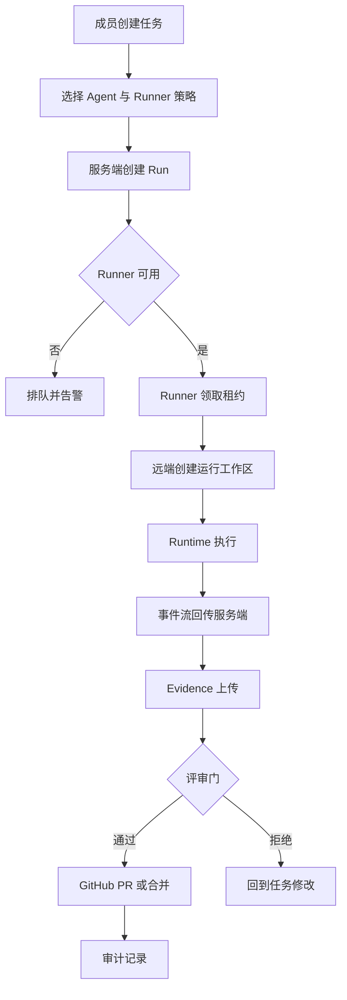

#### 9.4.2 步骤说明

| 步骤 | 操作者 | 动作 | 系统行为 | 输出/交付物 |
|---|---|---|---|---|
| F1 | 成员 | 创建团队任务 | 校验成员权限与团队可见性 | 任务 |
| F2 | 成员 | 选择 Agent 与 Runner 策略 | 支持自动匹配或指定 Runner；展示能力与在线状态 | Run 计划 |
| F3 | 服务端 | 创建 Run 并排队 | 检查 Agent 可用性、Runner 能力、仓库权限与并发配额 | queued Run |
| F4 | Runner | 领取租约 | 心跳有效、能力匹配、并发未满；租约有过期时间 | 租约 |
| F5 | Runner | 创建远端运行工作区 | 拉取基线、创建 worktree、注入受限凭据 | 远端工作区 |
| F6 | Runner | 执行 Runtime | 事件流回传；本地缓冲，断网可续传 | 事件与日志 |
| F7 | Runner | 上传 Evidence | 上传 diff、测试、截图；校验哈希与大小 | 证据包 |
| F8 | 成员/评审者 | 走评审门 | 设计、契约、合并、staging 按流程 D 执行 | 审批记录 |
| F9 | 系统/人类 | 创建 PR 或合并 | 优先创建 GitHub PR；受保护分支需审批 | PR 或合并记录 |
| F10 | 系统 | 写审计 | 记录动作、人、Run、证据、结果 | 审计日志 |

### 9.5 用户故事

| 编号 | Given/When/Then |
|---|---|
| US-F-01 | Given 我是团队成员且团队有在线 Runner，When 我发起 Run 并选择自动匹配，Then 系统把 Run 分配到满足 runtime 与仓库要求的 Runner。 |
| US-F-02 | Given Runner 在执行中掉线，When 心跳超时并超过宽限期，Then 其上活跃 Run 进入 failed 且 errorCode=interrupted、failureDetail=runner_lost，保留现场，不会在另一台机器静默重跑；人类决定重试或取消。 |
| US-F-03 | Given 我是任务发起人且团队启用四眼原则，When 我尝试批准自己的合并，Then 系统拒绝并提示需要另一名评审者。 |
| US-F-04 | Given 我只有 Viewer 角色，When 我尝试创建任务或发起 Run，Then 操作被拒绝且不产生副作用。 |
| US-F-05 | Given 一次 Run 使用了共享 Agent，When 管理员修改该 Agent，Then 已排队 Run 不受影响并使用快照配置。 |

### 9.6 功能需求

| 编号 | 需求 | 验收标准 | 里程碑 | 状态 |
|---|---|---|---|---|
| FLOW-F-001 | 团队必须支持登录、成员邀请与角色分配 | 未登录不可访问团队资源 | M3 | 计划（M3） |
| FLOW-F-002 | 权限矩阵必须在服务端强制执行 | 任何越权请求返回 403 并记录 | M3 | 计划（M3） |
| FLOW-F-003 | 任务、Agent、Run 必须有团队可见性规则 | 跨团队访问返回 404 或 403 | M3 | 计划（M3） |
| FLOW-F-004 | Runner 必须注册并定期心跳 | 离线 Runner 不再接收新 Run | M3 | 计划（M3） |
| FLOW-F-005 | Run 分配必须匹配 runtime、仓库与标签能力 | 不匹配时排队并提示原因 | M3 | 计划（M3） |
| FLOW-F-006 | 远端运行工作区必须隔离并受路径/命令边界约束 | 不同 Run 互不访问工作区 | M3 | 计划（M3） |
| FLOW-F-007 | Evidence 必须可断点续传并校验哈希 | 上传失败可重试；哈希不一致拒绝 | M3 | 计划（M3） |
| FLOW-F-008 | 高风险动作必须写审计 | 审计可按人、任务、Run、时间检索 | M3 | 计划（M3） |
| FLOW-F-009 | 合并优先走 GitHub PR | 可关联 PR 与 Run；PR 状态回写任务 | M3 | 计划（M3） |
| FLOW-F-010 | Runner 版本与协议必须兼容校验 | 版本不匹配拒绝领取任务并提示升级 | M3 | 计划（M3） |
| FLOW-F-011 | 团队必须支持并发配额与运行时长限制 | 超配额时排队或拒绝并提示 | M3 | 计划（M3） |
| FLOW-F-012 | 成员移除后其个人令牌立即失效 | 令牌失效后 API 返回 401 | M3 | 计划（M3） |
| FLOW-F-013 | 远程 Runner 凭据必须最小权限并可轮换 | 凭据泄露可撤销；撤销后无法访问仓库 | M3 | 计划（M3） |
| FLOW-F-014 | 网络传输必须使用 TLS | 非 TLS 连接被拒绝或显式告警 | M3 | 计划（M3） |
| FLOW-F-015 | 团队数据必须按团队隔离 | 跨团队查询无法返回数据 | M3 | 计划（M3） |
| FLOW-F-016 | 审计日志必须防篡改 | 审计只追加；校验失败告警 | M3 | 计划（M3） |
| FLOW-F-017 | Runner 失联必须用 failed + errorCode=interrupted + failureDetail=runner_lost 表达，不得新增 needs_attention 状态 | 心跳超时并超过宽限期后 Run 为 failed；错误码与 failureDetail 可查询；不自动改派 | M3 | 计划（M3） |

### 9.7 交付物

团队成员与角色记录、Runner 注册与心跳记录、远程 Run 与事件、证据包、PR/合并记录、审计日志、配额与使用报表。

### 9.8 异常与边界

| 异常 | 系统行为 | 人工处置 |
|---|---|---|
| Runner 离线 | Run 保持 queued；心跳 15 秒一次，连续 45 秒缺失判定 offline，租约 90 秒未续期视为过期；其上活跃 Run 进入 failed（errorCode=interrupted，failureDetail=runner_lost 或 lease_expired），不自动改派 | 恢复 Runner 或人工重试 |
| 租约过期 | 停止该 Runner 的执行授权，保留现场 | 人工决定重跑或恢复 |
| 网络分区 | 事件本地缓冲，恢复后续传 | 检查证据完整性 |
| Runner 版本不匹配 | 拒绝领取任务 | 升级 Runner |
| 仓库凭据失效 | Run failed，错误分类为环境问题 | 管理员更新凭据 |
| 证据上传失败 | 保留本地证据并重试 | 手动导出或重新上传 |
| 跨团队访问 | 返回 403/404 并审计 | 管理员核查 |
| 配额耗尽 | 排队并提示预计恢复时间 | 调整配额或等待 |

### 9.9 验收点

| 验收点 | 验证方式 | 里程碑 |
|---|---|---|
| 未登录无法访问团队 API | 直接请求返回 401 | M3 |
| Viewer 无法创建任务或发起 Run | 使用 Viewer 账号验证 | M3 |
| Runner 离线后不再分配新 Run | 停止心跳并观察调度 | M3 |
| Runner 失联后活跃 Run 以 interrupted/runner_lost 失败 | 模拟心跳超时，检查 Run 状态、errorCode 与 failureDetail | M3 |
| 跨团队任务不可见 | 两个团队账号交叉查询 | M3 |
| 审计覆盖合并与部署 | 检查审计记录完整性 | M3 |

## 10. 流程 G：Agent Team 讨论与转任务（M2.3）

### 10.1 目的与定位

流程 G 解决的是「需求尚未成形，需要先与不同角色讨论」的问题。用户把多个角色 Agent 组成一个 Agent Team（Agent 小组），在小组会话中发送消息；系统按消息内容把消息路由给最合适的成员，用户也可以用 `@` 定向。讨论结果可一键转为 Task，继续走流程 A/B 的执行与流程 D 的评审审批。

流程 G 是**讨论层**，不是执行层：会话 Agent 只读运行，不写仓库、不创建 Run/Artifact、不修改 Task；Agent 消息不参与路由，Agent 之间不得自动对话。它与流程 C（Crew）的区别是：Crew 是任务级的结构化执行编排，流程 G 是任务成形前的人类发起讨论。

### 10.2 前置条件

| 条件 | 说明 |
|---|---|
| 已存在多个 Agent | 至少两个可用的角色 Agent，且与小组同 Workspace |
| Runtime 支持只读模式 | Runtime 适配器支持 `read_only` 权限模式并禁用写工具 |
| 默认 Workspace 已就绪 | M2.3 的 AgentTeam 与会话归属 Workspace |
| 事件通道可用 | WS/SSE 可接收 `conversation.*` 事件 |

### 10.3 主流程

#### 10.3.1 时序图

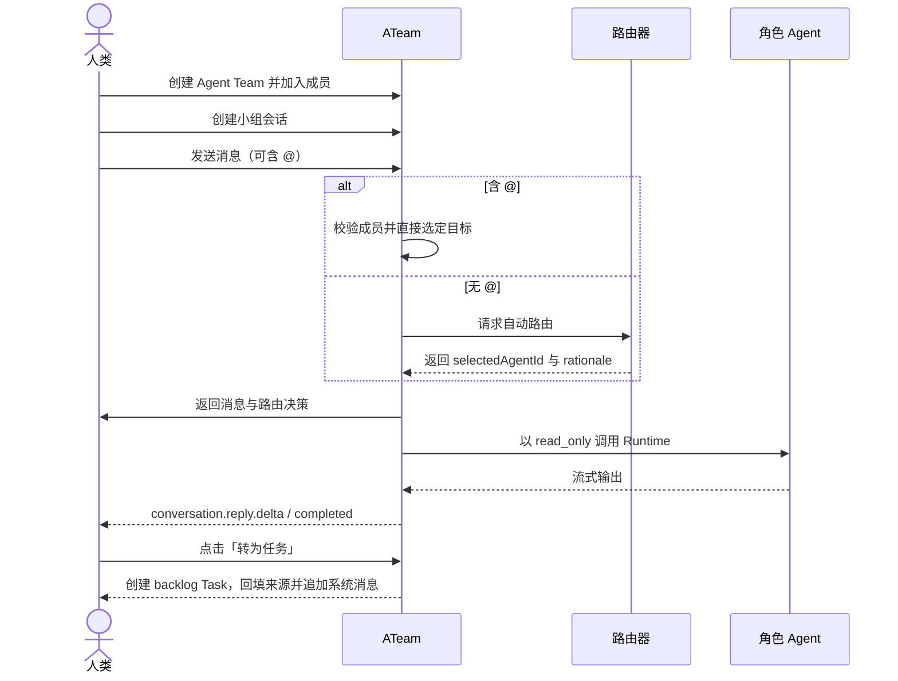

#### 10.3.2 步骤说明

| 步骤 | 操作者 | 动作 | 系统行为 | 输出/交付物 |
|---|---|---|---|---|
| G1 | 人类 | 创建 Agent Team 并加入成员 | 校验成员同 Workspace、未归档、组内唯一 | AgentTeam 与成员记录 |
| G2 | 人类 | 创建小组会话 | 创建 `active` 会话，默认标题取首条消息前 60 字符 | Conversation |
| G3 | 人类 | 发送消息 | 消息落库（`user`/`completed`）并解析 `@` | ConversationMessage |
| G4 | 系统 | 路由 | `@` 时校验成员；否则调用路由器并持久化 RoutingDecision | RoutingDecision |
| G5 | 系统 | 只读调用 Agent | `read_only` 权限、临时草稿目录、最近 20 条上下文 | 流式事件与 Agent 消息 |
| G6 | 人类 | 停止回复（可选） | 终止进程组，消息标记 `cancelled`，保留部分正文 | 取消事件 |
| G7 | 人类 | 一键转任务 | 幂等创建 backlog Task，回填来源，追加系统消息 | Task 与会话回执 |

### 10.4 交互与规则

1. 用户消息先落库再路由；路由失败时消息保留，返回稳定错误码，用户可 `@` 后重发。
2. `@` 覆盖自动路由；`@` 非成员或未知 Agent 返回 409 `AGENT_NOT_IN_TEAM`，消息不落库。
3. 自动路由单目标；无匹配返回 409 `ROUTING_NO_MATCH`，歧义返回 409 `ROUTING_AMBIGUOUS` 与候选。
4. 每个 Agent 回复展示路由标签与 rationale；路由决策可通过 API 查询。
5. 同一会话同一时间只允许一个非终态 Agent 回复；回复进行中再次发送返回 409 `CONVERSATION_BUSY`。
6. Agent 消息不参与路由、不触发其他 Agent；会话上下文不注入其他小组或 Workspace 内容。
7. 消息正文上限 32 KiB，超出截断并标记；会话上限 5,000 条或 20 MB。
8. 归档会话只读；归档不影响已创建 Task；会话不提供硬删除。
9. 转任务前可编辑标题与描述；同一消息重复转换返回同一 Task；转任务不自动启动 Run。

### 10.5 交付物

AgentTeam 与成员记录、Conversation 与消息时间线、RoutingDecision 记录、由消息转换的 Task（含 `originConversationId`/`originMessageId`）、会话事件流。

### 10.6 用户故事

| 编号 | Given/When/Then |
|---|---|
| US-G-01 | Given 我创建了包含 Frontend、Backend、DevOps 的小组，When 我发送「接口分页参数怎么设计？」，Then 消息被路由给 Backend Agent，回复上方显示路由依据。 |
| US-G-02 | Given 小组中有多个成员，When 我输入 `@Frontend` 并发送，Then 自动路由被跳过，只有 Frontend Agent 回复。 |
| US-G-03 | Given 消息无法明确归属，When 路由返回歧义，Then 我看到候选并可选择或 `@` 后重发，系统不随机选人。 |
| US-G-04 | Given 一个 Agent 正在生成回复，When 我点击停止，Then 5 秒内不再产生 delta，消息标记 `cancelled` 并保留已生成内容。 |
| US-G-05 | Given 我对一条 Agent 回复点击「转为任务」，When 我确认创建，Then 生成 backlog Task 并在会话中看到任务链接；再次点击不会重复创建。 |
| US-G-06 | Given 会话中的 Agent 尝试写文件，When 系统拒绝，Then 仓库无变化、无 Run/Artifact 产生，我可以在事件中看到拒绝原因。 |

### 10.7 异常与边界

| 异常 | 系统行为 | 人工处置 |
|---|---|---|
| 小组无成员 | 拒绝发送并提示先添加成员（`TEAM_MEMBER_REQUIRED`） | 添加成员 |
| `@` 非成员 | 409 `AGENT_NOT_IN_TEAM`，消息不落库 | 从选择器选择成员 |
| 路由无匹配 | 409 `ROUTING_NO_MATCH`，消息保留 | `@` 指定或调整成员 |
| 路由歧义 | 409 `ROUTING_AMBIGUOUS`，返回候选 | 选择候选或 `@` 重发 |
| 回复进行中再次发送 | 409 `CONVERSATION_BUSY` | 等待或停止当前回复 |
| 会话已归档 | 409 `CONVERSATION_ARCHIVED` | 新建会话 |
| Runtime 不可用 | 消息 `failed`，系统消息展示原因 | 检查 CLI 后重试 |
| 上下文超预算 | 截断最早消息并提示 | 新建会话或缩小问题 |
| 会话超上限 | 409 `CONVERSATION_LIMIT_REACHED` | 归档并新建会话 |
| 路由后成员被移除 | 历史决策保留；新消息不再路由到该成员 | 重新添加成员 |

### 10.8 功能需求

| 编号 | 需求 | 验收标准 | 里程碑 | 状态 |
|---|---|---|---|---|
| FLOW-G-001 | Agent Team 支持创建、重命名、归档与成员增删 | 成员同 Workspace 且组内唯一；重复返回 409 | M2.3 | 计划（M2.3） |
| FLOW-G-002 | 会话支持创建、列表、重命名、归档 | 归档后发送返回 409 | M2.3 | 计划（M2.3） |
| FLOW-G-003 | 消息不可变，`(conversationId, seq)` 唯一且可增量拉取 | 并发发送无重号；`afterSeq` 返回完整增量 | M2.3 | 计划（M2.3） |
| FLOW-G-004 | 自动路由单目标并持久化决策与 rationale | 决策可查询；UI 展示路由标签 | M2.3 | 计划（M2.3） |
| FLOW-G-005 | `@` 覆盖自动路由，非成员 `@` 被拒绝 | 定向消息仅目标 Agent 回复 | M2.3 | 计划（M2.3） |
| FLOW-G-006 | 会话 Agent 只读运行，不写仓库、不创建 Run/Artifact、不修改 Task | 负向用例无仓库变化 | M2.3 | 计划（M2.3） |
| FLOW-G-007 | Agent 消息不参与路由、不触发其他 Agent | 观察期无自动连锁回复 | M2.3 | 计划（M2.3） |
| FLOW-G-008 | Agent 回复流式推送并可停止 | 停止后 5 秒内无新 delta | M2.3 | 计划（M2.3） |
| FLOW-G-009 | 任意消息可幂等转为 Task 并回填来源 | 重复转换返回同一 Task | M2.3 | 计划（M2.3） |
| FLOW-G-010 | 会话页展示路由标签、`@` 选择器、成员状态与转任务入口 | UI-144 至 UI-152 通过 | M2.3 | 计划（M2.3） |
| FLOW-G-011 | 归档会话只读且不影响已创建 Task | 归档后消息拒绝，Task 可继续执行 | M2.3 | 计划（M2.3） |
| FLOW-G-012 | 路由歧义与无匹配返回稳定错误码与候选 | API 与 UI 均展示候选 | M2.3 | 计划（M2.3） |

### 10.9 验收点

| 验收点 | 验证方式 | 里程碑 |
|---|---|---|
| 自动路由选中正确角色并记录依据 | 路由夹具 + UI 检查 | M2.3 |
| `@` 覆盖自动路由且非成员被拒 | 定向与负向用例 | M2.3 |
| 会话 Agent 无写工具、无仓库变化 | `read_only` 负向用例 | M2.3 |
| Agent 不触发 Agent | 300 秒观察无连锁 | M2.3 |
| 转任务幂等且来源字段正确 | 重复调用与数据库检查 | M2.3 |
| 归档会话只读 | 归档后发送返回 409 | M2.3 |

## 11. 流程 H：Agent 状态看板与工作复盘（M2.4）

### 11.1 目的与定位

流程 H 解决的是「多个 Agent 同时存在时，用户如何判断谁在工作、谁刚完成、谁空闲」以及「如何从一个 Agent 进入其工作上下文与完成过程」。它补充 Run 视角，不替代 Run 详情：Run 详情是执行操作入口，Agent 工作页是只读的工作复盘入口。

流程 H 不引入新的执行实体，也不改变 Agent 生命周期；工作状态是 Run 的派生视图。

### 11.2 前置条件

| 条件 | 说明 |
|---|---|
| 已存在 Agent | 至少一个 Agent，且有或曾有 Run |
| Run 事件与快照可用 | M1 的 `run.*` 事件与 `run_config_snapshots` |
| 事件通道可用 | WS/SSE 可接收 Run 生命周期事件 |

### 11.3 主流程

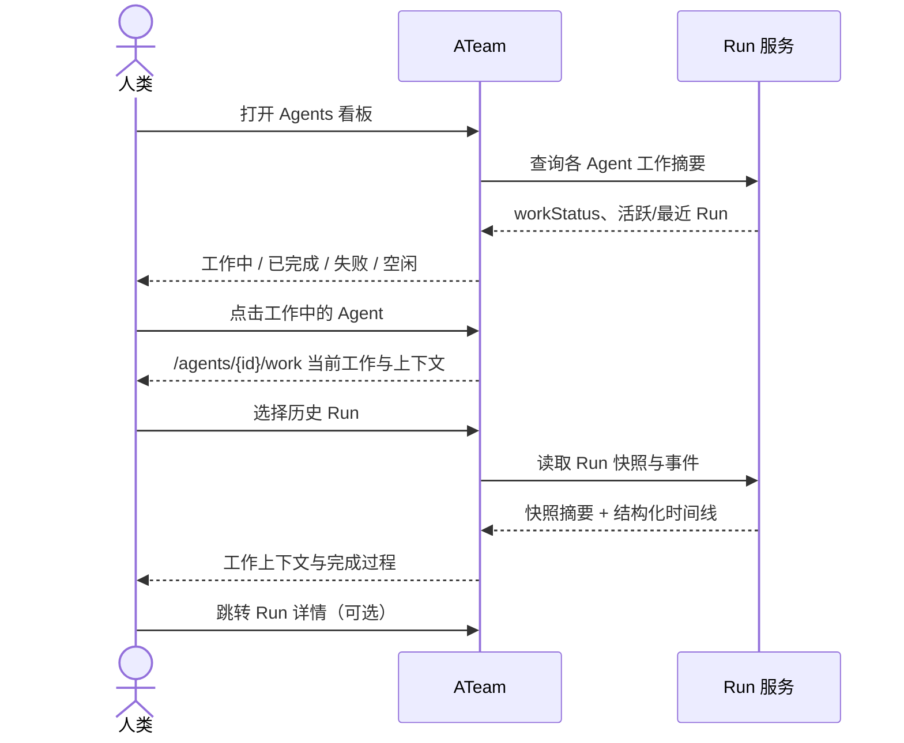

### 11.4 交互与规则

1. 看板状态由服务端派生：有活跃 Run 必为 `working`；无活跃 Run 不得为 `working`。
2. `completed`/`failed` 只在最近 24 小时内展示；超时回到 `idle`。
3. 归档 Agent 显示「已归档」并覆盖工作状态；历史工作只读。
4. 点击卡片正文进入 `/agents/{id}/work`；编辑配置使用独立入口。
5. 工作页默认选中活跃 Run，其次最近 Run；`?runId=` 保持选中。
6. 工作上下文展示 Task、配置快照摘要、Workspace/commit、权限模式与提示词哈希；不展示明文密钥、凭据值或完整拼装 prompt。
7. 完成过程只展示结构化事件，不混入普通日志；日志在 Run 详情查看。
8. 工作页只读，不提供编辑、启动、取消、审批或合并。
9. 状态随既有 `run.*` 事件更新；断线重连后重新拉取摘要。

### 11.5 交付物

Agent 工作摘要、工作页、工作上下文、完成过程时间线、历史工作列表、Run 快照查询端点与索引。

### 11.6 用户故事

| 编号 | Given/When/Then |
|---|---|
| US-H-01 | Given 看板上有多个 Agent，When 我查看，Then 我能区分工作中、已完成、失败待处理与空闲，并看到工作中 Agent 的当前任务与阶段。 |
| US-H-02 | Given 一个 Agent 正在运行，When 我点击它，Then 我进入工作页并看到当前 Run 的任务、阶段、工作区、分支与最近事件。 |
| US-H-03 | Given 一个 Agent 刚完成，When 我点击它，Then 默认展示刚结束的 Run，包含 Task 上下文、配置快照摘要与完成过程时间线。 |
| US-H-04 | Given 一个 Agent 空闲，When 我进入工作页，Then 我看到「尚无工作记录」空态，而不是伪造的上下文。 |
| US-H-05 | Given 一个 Agent 已归档，When 我进入工作页，Then 历史工作可查看且只读，没有编辑或启动入口。 |

### 11.7 异常与边界

| 异常 | 系统行为 | 人工处置 |
|---|---|---|
| Agent 不存在 | 404 `AGENT_NOT_FOUND` | 返回看板 |
| Run 不存在 | 404 `RUN_NOT_FOUND` | 选择其他 Run |
| 快照缺失 | 404 `RUN_SNAPSHOT_NOT_FOUND`；工作页显示「历史 Run 无完整快照」 | 查看 Run 事件或重新运行 |
| 多个活跃 Run | 状态保持 `working`，工作页列出全部 | 选择 Run 查看 |
| 状态竞态 | 以服务端查询为准；事件到达后刷新 | 重连或手动刷新 |
| 归档 Agent | 工作状态显示「已归档」，历史只读 | 恢复 Agent 后继续 |
| 快照含敏感字段 | 服务端脱敏；负向测试阻断发布 | 修复脱敏规则 |

### 11.8 功能需求

| 编号 | 需求 | 验收标准 | 里程碑 | 状态 |
|---|---|---|---|---|
| FLOW-H-001 | Agent 工作状态按 §11.4 派生并在看板展示 | 四种状态与归档态可见；与 Run 列表一致 | M2.4 | 计划（M2.4） |
| FLOW-H-002 | 点击工作中/已完成 Agent 进入工作页 | `/agents/{id}/work` 可直达；编辑入口独立 | M2.4 | 计划（M2.4） |
| FLOW-H-003 | 工作页展示当前工作与活跃 Run | 阶段、任务、时长、工作区/分支、最近事件可见 | M2.4 | 计划（M2.4） |
| FLOW-H-004 | 工作页展示工作上下文 | Task、配置快照摘要、Workspace/commit、权限模式、提示词哈希可见 | M2.4 | 计划（M2.4） |
| FLOW-H-005 | 工作页展示完成过程时间线 | 生命周期、工具、文件变更、测试、Artifact、评审/合并可过滤 | M2.4 | 计划（M2.4） |
| FLOW-H-006 | 工作页展示历史工作 | 最近 20 条 Run 及结果；空闲空态；归档只读 | M2.4 | 计划（M2.4） |
| FLOW-H-007 | 工作摘要与快照脱敏 | 无明文密钥、凭据值、完整拼装 prompt | M2.4 | 计划（M2.4） |
| FLOW-H-008 | 状态随 Run 事件实时更新并支持 `runId` 深链 | 2 秒内更新；刷新保持选中 | M2.4 | 计划（M2.4） |

### 11.9 验收点

| 验收点 | 验证方式 | 里程碑 |
|---|---|---|
| 看板状态与 Run 列表一致 | 并发创建/结束 Run 后对比 | M2.4 |
| 工作中/已完成 Agent 可进入工作页 | 点击走查 | M2.4 |
| 工作上下文与快照一致 | 对比 `GET /runs/{id}/snapshot` | M2.4 |
| 时间线不混入普通日志 | UI 检查与事件类型断言 | M2.4 |
| 快照不含敏感信息 | 脱敏负向用例 | M2.4 |
| 空闲与归档空态/只读 | 空态走查 | M2.4 |

## 12. 跨流程交接与一致性

### 12.1 交接矩阵

| 交接物 | 生产流程 | 消费流程 | 不可变要求 | 失效条件 |
|---|---|---|---|---|
| Task 上下文 | A/B/C/F | 所有 Run | Run 启动后不被后续编辑改变 | Task 归档 |
| Agent 配置快照 | A/B/F | 对应 Run | Run 生命周期内不变 | 无 |
| 设计版本 | B | 契约、前端 | 有版本与哈希 | 设计重新批准 |
| API 契约版本 | B | 前端、后端、集成 | 有版本与哈希 | 契约升级 |
| Diff 与测试证据 | A/B | 评审、合并 | 绑定 Run 与哈希 | 新 Run 或新提交 |
| 评审与合并/审批记录 | D | 合并、部署 | 只追加；M1 MergeRecord 绑定 expectedHeadCommit 与证据快照，M2 Approval 绑定 actionFingerprint | M1：head/证据快照不匹配（412）；M2：指纹不匹配（412，不可消费）、超时 expired、撤回 cancelled、已消费 consumed |
| 授权执行结果 | D | 任务、审计 | 绑定 reviewId/approvalId 与动作结果 | 执行失败可重试；M2 超时后审批 expired |
| 阻塞/升级记录 | E | 收件箱、审计 | 可追溯 | 关闭后仍保留 |
| 会话消息与来源 | G | Task、审计 | 消息不可变；Task 记录 `originConversationId`/`originMessageId`；路由决策只追加 | 会话归档（不阻断 Task） |
| Agent 工作状态与快照 | H | 看板、工作页、审计 | `workStatus` 只读派生；快照不可补写、已脱敏 | 归档（历史只读） |
| 审计日志 | F | 管理员、合规 | 只追加 | 无 |

### 12.2 一致性规则

1. 所有交接物必须绑定 ID 与哈希；禁止只靠文件名或自然语言描述交接。
2. 下游只能消费已冻结或已批准的版本；消费未批准版本必须显式标记为实验性。
3. 上游证据更新后，下游已批准结果必须标记 stale，不得静默沿用。
4. 任何流程都不得修改历史 Run 的终态、事件或证据；修正通过新 Run 或新审批完成。
5. 跨流程查询以服务端为准；前端缓存只用于展示，不作为审批依据。

## 13. 指标

| 指标 | 定义 | 目标 | 适用流程 | 里程碑 |
|---|---|---|---|---|
| 首次 Run 时间 | 任务创建到首次 Run 开始的中位数 | 不超过 2 分钟 | A | M0/M1 |
| Run 成功率 | completed / 总 Run | 基线建立后再定目标 | A/B/E | M1 |
| 评审等待时间 | 证据齐全到 Review/审批决定的中位数 | 不超过 1 个工作日 | D | M1/M2.1 |
| 合并前置时间 | Run 完成到合并的中位数 | 不超过 1 个工作日 | A/B | M1 |
| 重试率 | 有 retryOf 的 Run / 总 Run | 持续下降 | E | M1 |
| 阻塞升级率 | 进入 blocked 的任务 / 总任务 | 可解释并持续优化 | E | M2 |
| 流水线一次通过率 | 无退回完成的角色流水线 / 总流水线 | 建立基线 | B | M2.1 |
| Crew 完成率 | 达到摘要且通过合并的 Crew / 总 Crew | 建立基线 | C | M2.2 |
| staging 失败率 | staging 验证失败 / staging 部署 | 持续下降 | B/D | M2.1 |
| Runner 利用率 | 忙碌时间 / 在线时间 | 50%-80% | F | M3 |
| 审计完整率 | 有审计的高风险动作 / 全部高风险动作 | 100% | D/F | M3 |

### 13.1 非功能需求

| 编号 | 需求 | 验收标准 | 里程碑 | 状态 |
|---|---|---|---|---|
| FLOW-N-001 | 本地创建 Run 并入队 p95 不超过 500ms | 连续创建 100 次，记录 p50/p95；环境为本机 SSD、SQLite WAL、默认 worker=2；不含 Runtime 执行时间 | M0/M1 | 未验证（M0 无指标；M1 计划压测） |
| FLOW-N-002 | 本地事件从产生到界面可见不超过 1 秒 | WS 正常时测量 100 条事件的端到端延迟；断线时以轮询兜底 | M0/M1 | 部分实现（M0 轮询 1.5 秒兜底，WS 路径未测量；1 秒目标未验证） |
| FLOW-N-003 | 服务重启后不得静默丢失非终态 Run | 启动后 10 秒内 preparing/running 有明确归宿（failed/interrupted/app_restart），queued 有明确归宿 | M1 | 计划（M1） |
| FLOW-N-004 | 单 Run 1 万条事件仍可流畅浏览 | 虚拟列表或分页；滚动不卡顿 | M1 | 计划（M1） |
| FLOW-N-005 | 单 Run 日志与证据占用不超过配置上限 | 超限时截断并提示下载完整包 | M1 | 计划（M1） |
| FLOW-N-006 | 本地模式默认不上传代码与日志 | 无显式远程配置时零出站代码数据 | M0/M3 | 已实现（M0 本地） |
| FLOW-N-007 | 关键审批动作必须可键盘操作并可读屏 | 焦点顺序正确，按钮有可读标签 | M1/M2.1 | 计划（M1/M2.1） |
| FLOW-N-008 | 团队模式关键查询 p95 不超过 1 秒 | 1 万任务、10 万事件规模下测量 | M3 | 计划（M3） |

## 14. 依赖与风险

| 依赖/风险 | 影响 | 缓解措施 | 里程碑 |
|---|---|---|---|
| git worktree 与分支管理 | 流程 A 的真实闭环依赖它 | M1 优先实现并在异常仓库状态下给出明确错误 | M1 |
| Claude Code/Codex 流式协议稳定性 | 事件解析与证据采集受影响 | adapter 隔离协议差异；保留原始日志 | M1 |
| 本地 CLI 登录与配额 | Run 可能因外部认证失败 | 失败分类与配置引导；不转售模型 | M0/M1 |
| SQLite 并发与单写入者 | 多 worker 与前端查询可能竞争 | WAL、busy_timeout、单写入连接；M3 迁 Postgres | M0/M3 |
| 路径与命令边界 | 越权修改是最大安全风险 | M2.1 运行时强制执行；默认最小权限 | M2.1 |
| 审批状态与指纹语义漂移 | 不同文档对 expired/证据变化定义不一致会导致实现分叉 | 以 02-domain-model 4.6 为权威；模块文档评审时统一；增加跨文档一致性检查 | M1/M2.1 |
| 审批模型复杂度 | 门太多会拖慢个人开发者 | 单人模式可简化门；团队模式启用四眼 | M1/M3 |
| 远程 Runner 信任模型 | 代码与凭据在远端执行 | 最小权限凭据、TLS、租约、审计 | M3 |
| Windows 路径与 worktree 兼容 | 跨平台体验不一致 | 统一路径抽象；打包前专项测试 | M4 |
| Wails 打包与自动更新 | 分发体验与签名问题 | M4 专项里程碑；先保证本地 CLI | M4 |
| 产品范围膨胀 | 流程变复杂、交付延期 | 坚持先并行任务、后 Crew；非目标不进入主线 | 全程 |
| Agent 工作状态与 Run 列表不一致 | 看板失去信任 | 服务端唯一派生、一致性测试、复用 `run.*` 事件 | M2.4 |
| 工作页集中展示上下文导致泄漏 | 凭据或提示词暴露 | 快照脱敏、字段白名单、只读页面与跨 Workspace 404 | M2.4 |

## 15. 里程碑映射

| 流程 | M0 | M1 | M2 | M3 | M4 |
|---|---|---|---|---|---|
| A 单人单 Agent | 任务、Agent、Run、日志、取消、mock；无单活跃 Run 检查 | worktree、diff、证据、真实 Claude、Review+MergeRecord、重试、恢复、单活跃 Run、生命周期事件持久化、取消确认 | 角色模板复用（M2.1） | 远程 Runner 执行 | 自动触发入口 |
| B 角色流水线 | 无 | 基础任务与 Run 能力 | M2.1：DAG、契约、四个角色模板、路径权限、并行、人类集成步骤、DevOps staging；M2.2：Crew | 团队共享流水线 | 定时/Webhook 流水线 |
| C Crew | 无 | 无 | M2.2：Crew 与队长 | 团队 Crew | 无 |
| D 评审审批 | 无强制 | Review + MergeRecord、expectedHeadCommit/证据快照 412、本地确认 | M2.1：Approval、actionFingerprint、consumed、设计门、契约门、staging 门、prod 人工 | 四眼原则、审计导出、权限校验 | 通知与自动提醒 |
| E 异常处理 | 基础失败、取消、超时 | 分类、重试链、可靠取消、恢复、timeout 错误码 | 阻塞收件箱、升级级别、stalled 检测、T-11/T-12 重开与恢复 | 远程失败处理 | 自动重试策略 |
| F 团队模式 | 本地无登录 | 无 | 无 | Postgres、登录、两层角色权限、Runner、审计、PR、interrupted/runner_lost | 团队通知与报表 |
| G Agent Team 讨论 | 无 | 无 | M2.3：小组、会话、路由、`@`、只读讨论、流式停止、一键转任务 | 团队讨论复用 UI，数据模型独立 | 不变 |
| H Agent 状态复盘 | 无 | 无 | M2.4：工作状态、看板、工作页、上下文、完成过程、历史工作 | 团队视图复用工作页 | 不变 |

## 16. 与其他文档的关系

本章是「时间线」视角，模块章节是「能力」视角，两者需要交叉阅读。以下为具体文件与本章的对应关系：

- `prd/00-product-overview.md`：产品定位、核心闭环、目标用户与里程碑叙事。本章的所有流程都受本地优先、BYO Runtime、人工评审门与证据化 DoD 原则约束。
- `prd/01-scope-and-roadmap.md`：范围边界、M0-M4 目标与 M2.1/M2.2 拆分。本章的里程碑映射与角色模板数量以该文档为准。
- `prd/02-domain-model.md`：Workspace（项目）、Task、Agent、Run、RunEvent、运行工作区、Artifact、Approval、Skill、Crew 的字段、状态机与不变量。本章 1.4、3.1、3.3、7.3、8.5.1 直接引用其 4.2、4.3、4.4、4.6、7.3。
- `prd/04-acceptance-and-test-plan.md`：验收原则、AC 用例、测试矩阵与里程碑演示脚本。本章的 FLOW- 需求通过该文档 3.1 的 FR 前缀表登记，验收用例引用本章时使用 FLOW- 编号。
- `prd/05-risks-and-open-questions.md`：跨章节风险与待确认事项。本章第 17 节只保留本章特有的未决问题，已决策项不再重复。
- `prd/modules/task-management.md`：Task 状态、看板、DAG、删除保护与验收。流程 A、E 依赖该模块。
- `prd/modules/agent-system.md`：Agent 配置、版本、技能、路径与命令字段、角色模板。流程 A、B 依赖该模块。
- `prd/modules/runtime-and-workspace.md`：Run 生命周期、调度、取消、超时、worktree、Runtime adapter、Artifact/Evidence 采集。流程 A、E 依赖该模块。
- `prd/modules/collaboration-and-review.md`：任务 DAG、交付物契约、审批门、Crew、证据化 DoD、Review。流程 B、C、D 依赖该模块。
- `prd/modules/agent-teams-and-conversations.md`：Agent Team、会话、消息、路由与一键转任务。流程 G 依赖该模块。
- `prd/modules/security-and-permissions.md`：路径/命令 allowlist、密钥脱敏、审批内容绑定、团队角色与权限矩阵、Runner 凭据与审计。本章 5.4、5.5、9.3、10.4 引用其角色、权限模型与会话只读边界。
- `prd/modules/ui-ux.md`：Board、Task 详情、Run 日志、diff 查看器、审批面板、收件箱与可访问性。本章的 FLOW-A/B/D 交互规则是它的输入。
- `prd/modules/api-and-data.md`：REST/WS 端点、错误码、事件 schema、分页与迁移。本章 3.6 的资源与事件应与该模块契约一致。
- `prd/modules/non-functional-requirements.md`：性能、可靠性、可移植性、可观测性、资源与打包等 NFR 的权威定义；本章的 FLOW-N 需求是流程视角的补充，不替代该模块。
- `prd/milestones/M0-scaffold.md`、`M1-local-loop.md`、`M2-role-agents.md`、`M2.3-agent-teams.md`、`M2.4-agent-workbench.md`、`M3-team-mode.md`、`M4-automation-and-packaging.md`：各里程碑的目标、范围、退出标准与演示脚本。本章第 15 节是流程视角的映射，具体验收以里程碑文档与 `prd/04-acceptance-and-test-plan.md` 为准。

## 17. 已决策与待确认

### 17.1 已决策（不再列为待确认）

1. **Run 完成后任务是否自动进入 in_review**：已决策。M1 采用 `02-domain-model.md` 4.4 的状态联动：Run 完成且证据齐备时，系统可创建 `pending` Review 并把 Task 置为 `in_review`；证据不齐时只提示提交评审；任何情况下不得自动置为 `done`。决策记录见 FLOW-X-005 与 02-domain-model 4.4。M0 现状是 Run completed 后 Task 仍停留在 in_progress，需要人工 PATCH，这是已知缺口。

### 17.2 待确认/未文档化

以下问题尚未形成最终决策，需要在对应模块设计前确认：

1. worktree 的基线分支如何选择：固定使用项目默认分支，还是允许任务指定基线。建议默认分支加任务级覆盖，并记录基线提交。
2. 多仓库任务是否在 M2 支持。当前假设单仓库单 worktree；跨仓库会影响路径边界与集成流程，建议 M3 再评估。
3. Agent 配置快照的粒度：只快照 instructions/runtime/model/权限，还是包含完整环境变量引用。环境变量涉及密钥，建议只存引用与哈希。
4. M2 审批门在单人模式下是否全部启用。建议单人模式只强制合并门与 prod 门，设计与契约门可配置为提醒。
5. 契约格式是否只支持 OpenAPI 3.1。若未来支持 GraphQL 或 tRPC，需要定义不同契约类型的证据标准。
6. Crew 的默认预算、最大轮次与无进展判定阈值尚未量化，需要在上线前用真实任务标定。
7. 证据保留策略：默认保留多久、何时清理、是否需要导出归档。涉及磁盘占用与审计要求，需与团队模式一起定。
8. 团队模式的 Runner 信任边界：是否允许个人机器加入团队 Runner 池，以及如何隔离个人环境与团队凭据。
9. 通知渠道与收件箱的边界：M2 只做应用内收件箱，M4 再接外部通知；需要确认是否支持邮件或 IM，以及是否属于非目标。
10. 界面语言与文案规范：当前界面为英文，产品文档为中文；需要确认首发语言与后续本地化策略。
11. 自动重试的错误白名单：哪些错误允许自动重试、最大次数、是否需要人工确认，需在 M4 前明确。
